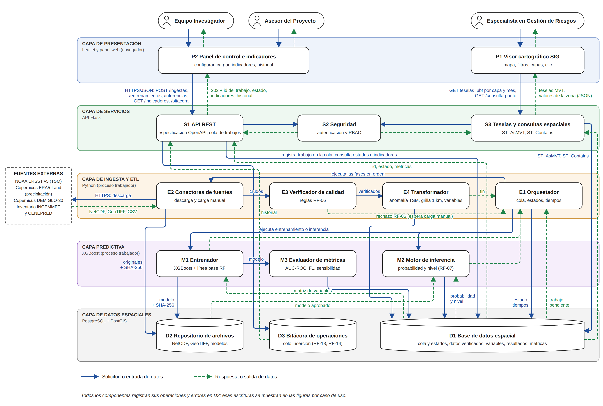
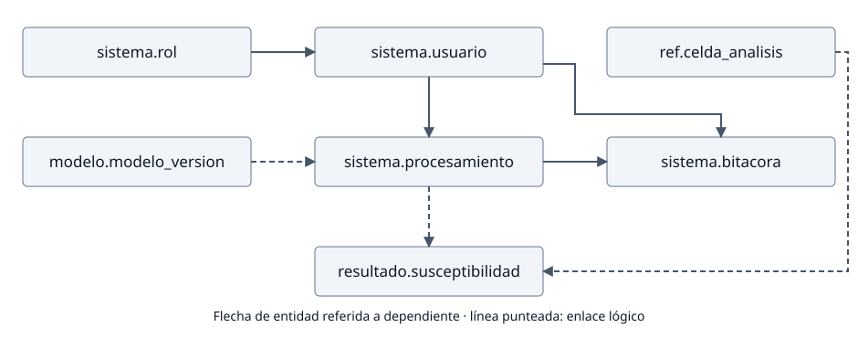

# Manual de mantenimiento

Sistema de estimación de susceptibilidad a deslizamientos por El Niño · versión 1.0.2

## 3.1 Introducción

Dirigido a quien mantendrá o ampliará el sistema sin haber participado en su construcción. Para instalarlo, empiece por el [manual técnico](manual_tecnico.md); para reproducir tareas en la interfaz, use el [manual de usuario](manual_usuario.md). La referencia de código de esta edición es la etiqueta `v1.0.2`; el paquete Python declara la versión `1.0.0`.

## 3.2 Arquitectura y decisiones de diseño

Se usa un monolito modular en cinco capas, con procesos separados para HTTP, ingesta y cálculo. Esto mantiene el despliegue en un host, separa los trabajos largos de las solicitudes y permite probar dependencias por contrato. Presentación no accede a D1 directamente; Servicios, ETL y Predictiva comparten las interfaces de Datos. Predictiva consume la matriz de D2, no importa ETL.



### 3.2.1 Presentación (P1 y P2)

| Campo | Detalle |
| --- | --- |
| Responsabilidad | Visor cartográfico y panel de operación. |
| Entradas y salidas | Recibe filtros y acciones; muestra mapas, estados, métricas y descarga CSV. |
| Depende de | API HTTP, Leaflet y Chart.js. |
| Ubicación | `presentacion/visor`, `presentacion/panel`, `presentacion/comun`. |
| Decisión | El navegador maneja interacción y visualización; la API aplica las reglas y permisos. |

### 3.2.2 Servicios (S1, S2 y S3)

| Campo | Detalle |
| --- | --- |
| Responsabilidad | API Flask, autenticación y autorización, y entrega de teselas. |
| Entradas y salidas | Recibe HTTP y devuelve JSON, estados HTTP, MVT o GeoJSON. |
| Depende de | Flask y repositorios de Datos. |
| Ubicación | `servicios/pfc_servicios/{api,seguridad,teselas}`. |
| Decisión | Validación y permisos en el servidor; los procesos largos se encolan. |

### 3.2.3 Ingesta y ETL (E1 a E4)

| Campo | Detalle |
| --- | --- |
| Responsabilidad | Orquestar, descargar o recibir datos, verificarlos y transformarlos. |
| Entradas y salidas | Lee trabajos y archivos oficiales o aportados; escribe estados, versiones y matriz Parquet. |
| Depende de | Repositorios, almacenamiento D2, configuración y proveedores externos. |
| Ubicación | `etl/pfc_etl/{orquestador,conectores,verificacion,transformacion}`. |
| Decisión | Separar conectores de reglas permite sustituir una fuente sin omitir la verificación. |

### 3.2.4 Predictiva (M1, M2 y M3)

| Campo | Detalle |
| --- | --- |
| Responsabilidad | Entrenar, inferir y evaluar el modelo y su deriva. |
| Entradas y salidas | Consume matriz, artefactos y parámetros; produce métricas, modelos versionados y resultados por celda y mes. |
| Depende de | Datos, XGBoost y scikit-learn. |
| Ubicación | `predictiva/pfc_predictiva/{entrenamiento,inferencia,evaluacion}`. |
| Decisión | El artefacto se verifica por huella y la prueba permanece separada temporalmente del ajuste. |

El protocolo usa entrenamiento 2000–2016, validación 2017–2019 y prueba sellada 2020–2026. No reajuste el modelo sobre la partición sellada. El valor histórico llamado `probabilidad` en D1 es un puntaje no calibrado; la interfaz no debe presentarlo como probabilidad de un evento.

### 3.2.5 Datos espaciales (D1, D2 y D3)

| Campo | Detalle |
| --- | --- |
| Responsabilidad | Persistencia de referencia y resultados, almacenamiento de archivos y bitácora. |
| Entradas y salidas | Escribe entidades, archivos y eventos; devuelve consultas, artefactos y metadatos. |
| Depende de | SQLAlchemy, Psycopg, PostgreSQL/PostGIS y sistema de archivos. |
| Ubicación | `datos/pfc_datos`, `datos/sql`, `datos/respaldo`. |
| Decisión | PostGIS soporta consultas espaciales, Parquet evita cargar matrices grandes en D1 y la bitácora es de solo inserción. |

## 3.3 Estructura del código

```text
presentacion/       Visor, panel y cliente compartido
servicios/         Recursos HTTP, autenticación y teselas
etl/               Orquestación, conectores, verificación y transformación
predictiva/        Entrenamiento, inferencia y evaluación
datos/             Repositorios, modelos, SQL y respaldo
api/               Contrato OpenAPI
config/            Configuración del dominio y del modelo
pruebas/           Unitarias, integración, sistema y carga
despliegue/        Docker, proxy y scripts de staging
scripts/           Herramientas operativas y de documentación
```

Use `snake_case` en módulos y funciones Python, `PascalCase` en clases y las convenciones de los módulos vecinos. Black y Ruff usan 99 columnas y objetivo Python 3.11. `import-linter` comprueba los límites de capas declarados en `pyproject.toml`.

## 3.4 Modelo de datos



El SQL de [`01_esquema.sql`](../datos/sql/01_esquema.sql) y [`02_operacion.sql`](../datos/sql/02_operacion.sql) define los cinco esquemas. Las fichas detallan las tablas del recorrido principal; el SQL también define catálogos, fuentes, variables, métricas y series. Los GiST de celda e inventario aceleran consultas espaciales; los índices de cola y bitácora aceleran la selección de trabajos y el filtrado de eventos.

### 3.4.1 `sistema.rol`

| Columna | Tipo | Obligatoria | Descripción |
| --- | --- | --- | --- |
| `id_rol` | smallint | Sí | Clave primaria. |
| `codigo` | varchar(20) | Sí | Código único del permiso funcional. |
| `descripcion` | varchar(200) | Sí | Descripción del rol. |

### 3.4.2 `sistema.usuario`

| Columna | Tipo | Obligatoria | Descripción |
| --- | --- | --- | --- |
| `id_usuario` | integer | Sí | Clave primaria generada. |
| `id_rol` | smallint | Sí | FK a `sistema.rol`. |
| `nombre` | varchar(100) | Sí | Nombre visible. |
| `correo` | varchar(150) | Sí | Identificador de ingreso único. |
| `hash_clave` | varchar(255) | Sí | Hash Argon2id; no guardar claves. |
| `activo` | boolean | Sí | Habilitación, activa por defecto. |
| `intentos_fallidos` | smallint | Sí | Contador no negativo, inicialmente cero. |
| `bloqueado_hasta` | timestamptz | No | Fin del bloqueo temporal. |
| `creado_en` | timestamptz | Sí | Fecha de creación. |

### 3.4.3 `sistema.procesamiento`

| Columna | Tipo | Obligatoria | Descripción |
| --- | --- | --- | --- |
| `id_procesamiento` | integer | Sí | Clave primaria e identificador de cola. |
| `id_usuario` | integer | Sí | FK al usuario solicitante. |
| `id_umbral_version` | integer | No | FK a la versión de umbrales. |
| `id_modelo_version` | integer | No | Identificador de la versión de modelo. |
| `tipo` | varchar(15) | Sí | Ingesta, entrenamiento o inferencia. |
| `fecha_desde`, `fecha_hasta` | date | Sí | Ventana; el fin no precede al inicio. |
| `zona` | geometry(MultiPolygon, 4326) | Sí | Ámbito geográfico. |
| `estado` | varchar(15) | Sí | Estado de cola; inicialmente `PENDIENTE`. |
| `fase` | varchar(20) | No | Etapa indicada por el worker. |
| `iniciado_en`, `finalizado_en` | timestamptz | No | Marcas de ejecución en orden cronológico. |
| `memoria_max_gb` | numeric(6,2) | No | Pico de memoria no negativo. |
| `tiempos_s` | jsonb | No | Tiempo por fase en segundos. |
| `resumen` | jsonb | No | Resumen estructurado de la ejecución. |
| `ubigeo_dep` | char(2) | No | FK a departamento; nulo para toda la macrorregión. |

El índice único parcial `ux_procesamiento_activo` impide que coexistan dos trabajos pendientes, en curso o en espera.

### 3.4.4 `sistema.bitacora`

| Columna | Tipo | Obligatoria | Descripción |
| --- | --- | --- | --- |
| `id_evento` | bigint | Sí | Clave primaria generada. |
| `ocurrido_en` | timestamptz | Sí | Fecha de registro, indexada. |
| `tipo` | varchar(12) | Sí | `INFORMATIVO`, `ADVERTENCIA` o `ERROR`. |
| `componente` | varchar(30) | Sí | Emisor del evento. |
| `descripcion` | text | Sí | Resumen del evento. |
| `id_usuario`, `id_procesamiento` | integer | No | FKs al actor y al trabajo cuando aplican. |
| `detalle` | jsonb | No | Contexto estructurado. |

Un disparador rechaza actualizaciones y eliminaciones; no use la edición directa como mecanismo de corrección.

### 3.4.5 `ref.celda_analisis`

| Columna | Tipo | Obligatoria | Descripción |
| --- | --- | --- | --- |
| `id_celda` | integer | Sí | Clave primaria de la grilla. |
| `ubigeo_prov` | char(4) | No | Código de provincia indexado. |
| `id_pixel` | integer | Sí | Píxel ERA5-Land que cubre la celda. |
| `geom` | geometry(Polygon, 32717) | Sí | Geometría original, con índice GiST. |
| `geom_3857` | geometry(Polygon, 3857) | Generada | Web Mercator para teselas; índice GiST. |

### 3.4.6 `modelo.modelo_version`

| Columna | Tipo | Obligatoria | Descripción |
| --- | --- | --- | --- |
| `id_modelo_version` | integer | Sí | Clave primaria generada. |
| `algoritmo`, `version` | varchar(20) | Sí | Par único; algoritmo limitado a XGBoost o Random Forest. |
| `estado` | varchar(10) | Sí | Estado de aprobación o revisión. |
| `ruta_artefacto` | varchar(300) | Sí | Ubicación del artefacto. |
| `sha256` | char(64) | Sí | Huella esperada del artefacto. |
| `hiperparametros` | jsonb | Sí | Parámetros usados para el ajuste. |
| `referencia_psi` | jsonb | No | Referencia para analizar deriva. |
| `entrenado_en` | timestamptz | Sí | Fecha del entrenamiento o registro. |

### 3.4.7 `resultado.susceptibilidad`

| Columna | Tipo | Obligatoria | Descripción |
| --- | --- | --- | --- |
| `id_procesamiento`, `id_celda` | integer | Sí | Identificadores de trabajo y celda; parte de la clave. |
| `periodo` | date | Sí | Primer día del mes; completa la clave y define la partición anual. |
| `probabilidad` | numeric(5,4) | Sí | Puntaje entre 0 y 1, no calibrado. |
| `nivel` | smallint | Sí | Clase de 1 a 4. |
| `precip_mes_mm`, `precip_max3d_mm` | numeric(7,1) | Sí | Acumulado mensual y máximo de tres días; no negativos. |
| `precip_ant90_mm` | numeric(8,1) | Sí | Acumulado antecedente de 90 días; no negativo. |

## 3.5 Interfaces y API

Las rutas se exponen bajo `/api`. La fuente completa de métodos, seguridad, esquemas, parámetros y respuestas es el [contrato OpenAPI](../api/openapi.yaml). Las tablas siguientes son fichas abreviadas: cada fila corresponde a un método y una ruta. Las mutaciones protegidas usan el token CSRF definido en el contrato. `400` indica solicitud inválida, `401` ausencia de sesión y `403` rol no autorizado cuando están declarados.

### 3.5.1 Sesión y salud

| Método y ruta | Propósito y autenticación | Solicitud | Éxito y errores |
| --- | --- | --- | --- |
| `GET /sesion/csrf` | Preparar el token; sin inicio de sesión previo. | Sin cuerpo. | `200`: token CSRF. |
| `POST /auth/login` | Iniciar sesión con CSRF. | JSON con `correo` y `clave`. | `204`: cookie de sesión; `400`, `401`, `423` bloqueada, `429` límite. |
| `GET /sesion` | Consultar la sesión. | Cookie. | `200`: sesión vigente; `401`. |
| `DELETE /sesion` | Cerrar la sesión. | Token CSRF. | `204`: cierre. |
| `GET /salud` | Comprobar API y base; sin autenticación. | Sin parámetros. | `200`: disponible; `503`: base no disponible. |

### 3.5.2 Procesamientos

Para el Equipo Investigador. Las creaciones reciben un JSON, conforme a los esquemas o ejemplos de solicitud de OpenAPI. Las rutas con `{id}` reciben un entero positivo.

| Método y ruta | Propósito | Solicitud | Éxito y errores |
| --- | --- | --- | --- |
| `POST /ingestas` | Encolar ingesta. | Ventana de ingesta. | `202`: encolada; `400`, `401`, `403`, `409` trabajo activo. |
| `GET /procesamientos/activo` | Recuperar el trabajo actual. | Sin parámetros. | `200`: estado; `204`: sin trabajo; `401`, `403`. |
| `GET /ingestas/{id}` | Consultar ingesta. | `id`. | `200`: estado; `401`, `403`, `404`. |
| `POST /ingestas/{id}/archivos` | Reanudar la ingesta en espera. | `id`, multipart `archivo` y `fuente`. | `201`: archivo y huella registrados; `400`, `401`, `403`, `404`, `409` estado, `415` formato, `422` tamaño. |
| `POST /entrenamientos` | Encolar entrenamiento. | Ventana de entrenamiento. | `202`: encolado; `400`, `401`, `403`, `409` trabajo activo, `422` sin datos verificados. |
| `POST /inferencias` | Encolar inferencia. | Ventana, versión y ámbito según el contrato. | `202`: encolada; `400`, `401`, `403`, `409` trabajo activo, `422` versión o huella. |
| `GET /inferencias/{id}` | Consultar inferencia. | `id`. | `200`: estado; `401`, `403`, `404`. |
| `POST /procesamientos/{id}/cancelar` | Cancelar un trabajo no finalizado. | `id`. | `204`: cancelado; `401`, `403`, `404`, `409` ya terminó. |

### 3.5.3 Visor y panel

El visor requiere sesión de investigador o especialista. Indicadores e historial requieren sesión de investigador o asesor.

| Método y ruta | Propósito | Solicitud | Éxito y errores |
| --- | --- | --- | --- |
| `GET /mapas/{capa}/{periodo}/{z}/{x}/{y}.pbf` | Entregar una tesela. | Capa, mes, coordenadas de tesela; departamento o provincia opcionales. | `200`: MVT; `204`: vacía; `400`, `401`, `403`, `404` periodo o capa. |
| `GET /consulta-punto` | Consultar una celda. | `periodo`, `lat`, `lon`. | `200`: nivel, puntaje y variables; `400`, `401`, `403`, `404`. |
| `GET /periodos` | Enumerar meses disponibles. | Sin parámetros. | `200`: lista `AAAA-MM`; `401`, `403`. |
| `GET /ambitos` | Enumerar ámbitos geográficos. | Sin parámetros. | `200`: departamentos, provincias y cajas; `401`, `403`. |
| `GET /capas/limites` | Obtener límites provinciales. | Sin parámetros. | `200`: GeoJSON; `401`, `403`. |
| `GET /indicadores` | Consultar métricas y operación. | Sin parámetros. | `200`: indicadores; `401`, `403`. |
| `GET /bitacora` | Consultar el historial. | `desde`, `hasta` y `tipo` opcionales. | `200`: eventos en orden descendente; `400`, `401`, `403`. |

## 3.6 Dependencias

| Dependencia | Versión o restricción | Uso |
| --- | --- | --- |
| Flask, Flask-WTF, Gunicorn | 3.1.3, 1.3.0, 26.2.0 | API, CSRF y proceso HTTP. |
| SQLAlchemy, Psycopg, Argon2-cffi | 2.1.6, 3.3.4, 25.1.0 | Persistencia y verificación de credenciales. |
| pandas, NumPy, PyArrow | 2.3.3, 2.3.5, 25.0.0 | Transformación tabular y Parquet. |
| XGBoost, scikit-learn | 3.2.0, 1.9.1 | Entrenamiento y evaluación. |
| GeoPandas, Rasterio, xarray, cdsapi | >=1.0, >=1.4, >=2025.1, >=0.7 | Extra geoespacial y conexión a CDS. |
| pytest, pytest-cov | 9.1.1, 7.1.0 | Pruebas y cobertura. |
| NOAA, Copernicus, INGEMMET y CENEPRED | ERSST v5, ERA5-Land, DEM GLO-30 e inventarios oficiales | Proveedores de temperatura, lluvia, terreno e inventario. |

Las versiones son las declaradas en `pyproject.toml`; revise ese archivo para la lista completa y las dependencias opcionales. Las fuentes oficiales se distribuyen por separado, con sus propias condiciones.

## 3.7 Cómo extender el sistema

Ejemplo de cambio futuro: exponer en el visor una nueva capa derivada de datos de referencia.

1. Defina la semántica, unidad, periodo y representación sin datos. Compruebe si D1 ya tiene los campos o si hace falta un cambio SQL revisado.
2. Añada la consulta espacial en Datos y conéctela a la generación de teselas. Use las consultas vecinas como patrón y conserve filtros y límites.
3. Registre la capa en el recurso de mapas y en el `enum` del contrato OpenAPI. Mantenga autorización y tratamiento de una tesela vacía o un periodo inexistente.
4. Añada la capa y su leyenda al visor siguiendo los controles de `presentacion/visor/js/mapa.js`; no duplique la lógica de permisos en el cliente.
5. Cubra consulta y validación en unitarias, MVT y filtros con PostGIS en integración, y visualización en sistema. Actualice el manual de usuario si el cambio se libera.

## 3.8 Pruebas, CI/CD y registro de cambios

En Python 3.11, instale `pip install -e '.[dev,geo]'` y ejecute desde la raíz:

```bash
ruff check .
black --check .
lint-imports
pytest pruebas/unitarias --cov --cov-report=term-missing
pytest pruebas/integracion --cov --cov-report=xml:coverage.xml
```

Ejecute integración solo con `PFC_BD_URL` hacia una base desechable y exclusiva, nunca contra la base del sistema. Para pruebas de navegador use el entorno dedicado de `despliegue/pruebas`, configure `PFC_BD_URL_SISTEMA` y ejecute `PFC_SISTEMA=1 PYTHONPATH=pruebas/sistema:$PYTHONPATH pytest pruebas/sistema`. Para reproducir la calidad del proyecto consulte `scripts/pipeline_local.py` y la configuración de SonarQube.

El flujo [CI/CD](../.github/workflows/ci-cd.yml) ejecuta controles estáticos y pruebas con PostGIS, publica cobertura y usa SonarQube. En `main` se construyen imágenes y se despliega a staging cuando están disponibles el registro, el entorno y sus secretos. El script de staging incorpora prueba de humo y reversión. No incluya internos ni secretos en el historial de cambios.

| Versión publicada | Fecha | Cambios |
| --- | --- | --- |
| `v1.0.0` | 2026-11-18 | Entrega inicial con validación y licencia MIT. |
| `v1.0.1` | 2026-11-18 | Manuales por caso de uso, con capturas. |
| `v1.0.2` | 2026-11-18 | PDF y captura del procesamiento en curso. |

Consulte `git log --oneline` para los cambios posteriores y `git tag --list` para las versiones publicadas.