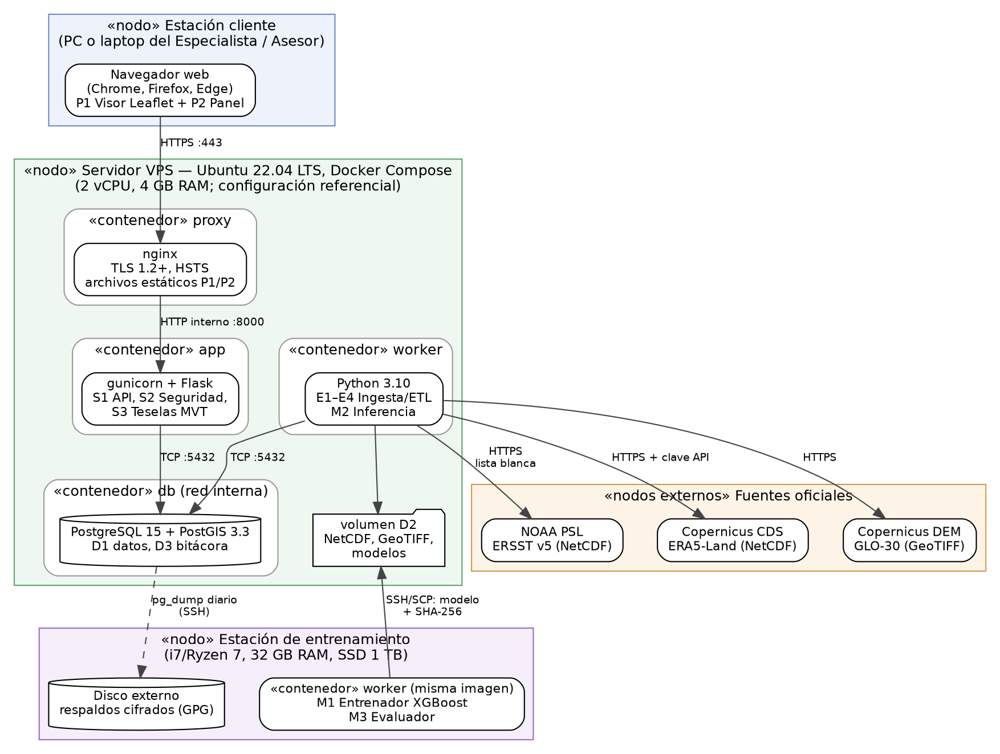

# Manual técnico de instalación

Sistema de estimación de susceptibilidad a deslizamientos por El Niño · versión 1.0.2

## 2.1 Introducción

Guía para personal técnico con conocimientos de Linux, Docker Compose, TLS y PostgreSQL. Instala la pila de staging de la versión publicada `v1.0.2`, verifica el acceso y explica la recuperación. No incluye los datos oficiales ni sustituye el procedimiento de entrenamiento. Para cambios de código consulte el [manual de mantenimiento](manual_mantenimiento.md).

## 2.2 Arquitectura de despliegue

En un mismo host, el navegador accede por HTTPS a Nginx. Nginx sirve el visor y el panel y reenvía `/api/` a `app`. La API, `worker` (ETL y entrenamiento) y `worker-m2` (inferencia) acceden a PostgreSQL/PostGIS por la red interna. Comparten D2 para matrices, cargas y artefactos. Los datos de origen se montan de solo lectura para `worker`. Staging publica el proxy en `127.0.0.1:8443` y la base en `127.0.0.1:5434`; el acceso remoto debe configurarlo el operador mediante una entrada HTTPS autorizada.



## 2.3 Requisitos

| Elemento | Requisito o versión de referencia |
| --- | --- |
| Host mínimo previsto | 2 vCPU, 4 GB de RAM y 40 GB libres; dimensione aparte los datos de origen y respaldos. |
| Entorno de referencia | Ubuntu 24.04.3 LTS; Docker Engine 29.1.3 y Compose 2.40.3. |
| Aplicación y workers | Python 3.11.18, incluido en las imágenes. |
| Base | Imagen `postgis/postgis:18-3.7-alpine`; referencia del proyecto: PostgreSQL 18.6, PostGIS 3.7.0. |
| Proxy | Nginx 1.30.6, incluido en la imagen. |
| Herramientas | Git, curl, OpenSSL y acceso a un registro OCI. Para respaldo, cliente PostgreSQL 18 y GnuPG. |
| Fuentes | Datos crudos por separado; para descargas de ERA5-Land se necesita una cuenta del Climate Data Store. |

## 2.4 Instalación de la base de datos

### 2.4.1 Requisitos previos

Docker operativo, registro accesible y un volumen nuevo para la primera instalación. El comando de Compose requiere que `.env` exista y defina los tres valores obligatorios de 2.6; complete esa configuración mínima antes de ejecutar `up`. No use un volumen con datos de otra instalación.

### 2.4.2 Pasos y comandos

1. Obtenga el código. `git describe --tags --exact-match` debe mostrar `v1.0.2`.

   ```bash
   git clone --branch v1.0.2 https://github.com/diegobfcy/pfc-susceptibilidad.git
   cd pfc-susceptibilidad
   git describe --tags --exact-match
   ```

2. Defina `PFC_REGISTRO` con el registro autorizado y `PFC_VERSION` con `v1.0.2`. Si la imagen de base aún no está publicada, constrúyala y súbala. Ambos comandos deben terminar sin errores.

   ```bash
   export PFC_REGISTRO=localhost:5000 PFC_VERSION=v1.0.2
   docker build -f despliegue/Dockerfile.db -t "$PFC_REGISTRO/pfc-db:$PFC_VERSION" .
   docker push "$PFC_REGISTRO/pfc-db:$PFC_VERSION"
   ```

3. Inicie la base. El primer arranque crea `pfc` y el usuario inicial `postgres`, y aplica `01_esquema.sql` y `02_operacion.sql` en ese orden. Compose debe marcar `db` como saludable.

   ```bash
   docker compose up -d --wait db
   ```

### 2.4.3 Verificación

```bash
docker compose exec -T db psql -U postgres -d pfc -v ON_ERROR_STOP=1 \
  -c 'SELECT postgis_lib_version();' \
  -c 'SELECT codigo FROM sistema.rol ORDER BY codigo;'
```

Se espera PostGIS 3.7 y los tres roles `ASESOR`, `ESPECIALISTA` e `INVESTIGADOR`. Las cuentas funcionales y los datos de referencia se preparan en 2.7.

### 2.4.4 Si algo falla

Revise `docker compose logs --tail=100 db`. Los scripts de inicialización no se vuelven a ejecutar si el volumen ya existe; compruebe el esquema antes de aplicar cambios. No elimine el volumen para corregir una instalación con datos.

## 2.5 Instalación de la aplicación

### 2.5.1 Requisitos previos

Repositorio en la etiqueta indicada, base verificada y acceso de escritura al registro si se publicarán imágenes. Use el mismo registro y etiqueta que en 2.4.

### 2.5.2 Pasos y comandos

1. Si las imágenes no están publicadas, ejecute el comando de construcción. Debe publicar `app`, `worker`, `db` y `proxy`; `worker-m2` reutiliza la imagen de `worker`.

   ```bash
   ./despliegue/construir_y_publicar.sh "$PFC_VERSION"
   ```

2. Descargue las imágenes en el host de ejecución. El sitio web no requiere compilación: Nginx monta `presentacion/` directamente.

   ```bash
   docker compose pull
   ```

### 2.5.3 Verificación

`docker compose config --images` debe enumerar las cuatro imágenes con el registro y la etiqueta elegidos. `docker compose pull` debe descargar o confirmar cada una sin errores.

### 2.5.4 Si algo falla

Si el registro no responde, revise su disponibilidad y autenticación. Ante una etiqueta inexistente, confirme que fue publicada en el registro correcto y que `PFC_VERSION` está exportada en la sesión actual.

## 2.6 Configuración

### 2.6.1 Requisitos previos

Ruta local para los datos oficiales, un par TLS autorizado y un mecanismo para generar y custodiar secretos. No reutilice secretos del entorno de pruebas en otros entornos.

### 2.6.2 Pasos y comandos

1. Cree `.env` a partir de la plantilla en una instalación nueva. El archivo debe quedar fuera de Git.

   ```bash
   (umask 077; cp -n .env.example .env)
   chmod 600 .env
   ```

2. Edite `.env` y sustituya los valores de ejemplo. Genere valores aleatorios independientes para la base y la sesión; `openssl rand -hex 32` genera uno por ejecución. Guárdelos sin copiarlos a documentación o tickets.

   | Variable | Propósito | Ejemplo no secreto |
   | --- | --- | --- |
   | `POSTGRES_PASSWORD` | Contraseña inicial de PostgreSQL | Generar una cadena hexadecimal propia |
   | `PFC_SECRETO_SESION` | Firma de la sesión | Generar otra cadena distinta |
   | `PFC_DATOS_ORIGEN` | Directorio absoluto montado en el worker | `/srv/pfc/origen` |
   | `PFC_REGISTRO`, `PFC_VERSION` | Selección de imágenes | `localhost:5000`, `v1.0.2` |
   | `PFC_BD_URL` | URL SQLAlchemy para herramientas nativas; Compose construye la suya | `postgresql+psycopg://usuario@127.0.0.1:5434/pfc` |
   | `PFC_D2`, `PFC_CONFIG` | Directorio de artefactos y ruta YAML alternativa en ejecución nativa | `/srv/pfc/d2`, `config/config.yaml` |

3. Instale el certificado y su clave como `pfc.crt` y `pfc.key` en `despliegue/nginx/tls/`. Proteja la clave privada. Revise en `config/config.yaml` el periodo, reglas de verificación, fuentes y umbrales antes de preparar datos; no cambie el protocolo del modelo sin validarlo.

### 2.6.3 Verificación

`docker compose config --quiet` debe terminar con código 0. Compruebe que la ruta de datos sea legible y que `openssl x509 -in despliegue/nginx/tls/pfc.crt -noout -dates` muestre fechas vigentes. No imprima la configuración expandida con secretos.

### 2.6.4 Si algo falla

Una variable obligatoria ausente impide resolver Compose: compruebe el nombre y que ejecuta desde la raíz. Si solo falla el proxy, revise la ruta, permisos y correspondencia de la clave y el certificado.

## 2.7 Puesta en marcha y verificación

### 2.7.1 Requisitos previos

Base, imágenes y TLS verificados; puertos locales libres. Para acceder desde otro equipo, use la dirección y el certificado aprobados por el operador.

### 2.7.2 Pasos y comandos

1. Inicie los servicios y compruebe su estado. Deben quedar activos `db`, `app`, `worker`, `worker-m2` y `proxy`.

   ```bash
   docker compose up -d --wait
   docker compose ps
   ```

2. Cree la primera cuenta funcional. El comando solicita la clave sin mostrarla y también permite restablecer una cuenta existente; la interfaz no administra cuentas.

   ```bash
   docker compose exec app python -m pfc_servicios.admin operador@example.org INVESTIGADOR --nombre "Operador de pruebas"
   ```

3. Para ofrecer mapas, prepare y cargue el conjunto de referencia con `scripts/cargar_referencias.py` en el entorno nativo del proyecto, con `PFC_BD_URL` y las rutas de datos configuradas. El repositorio no incluye el conjunto completo. Compruebe `SELECT count(*) FROM ref.celda_analisis;` (108 461 celdas para la referencia completa) y publique resultados mediante una inferencia válida.

4. Para detener sin borrar volúmenes use `docker compose stop`; para volver a iniciar, `docker compose up -d --wait`. Para reiniciar solo la aplicación, use `docker compose restart app`.

### 2.7.3 Verificación

Con un certificado confiable válido para `localhost`, `curl --fail --silent --show-error https://localhost:8443/api/salud` debe mostrar `{"estado":"ok"}`. Si la confianza es privada, agregue `--cacert` con la ruta de su CA y use un nombre cubierto por el certificado. Abra `/panel/` en la misma dirección, inicie sesión y confirme que aparecen **Procesamientos**, **Indicadores** e **Historial**. Si ya cargó resultados, verifique también un mapa en `/visor/`.

### 2.7.4 Si algo falla

Use `docker compose logs --tail=100 proxy app worker worker-m2 db`. Si salud funciona pero falla el ingreso, confirme el rol y el secreto de sesión. Si un trabajo no avanza, revise ambos workers, el estado de la cola y la disponibilidad de los datos de origen y D2.

## 2.8 Respaldo, restauración y problemas comunes

Programe un respaldo diario y conserve copias externas protegidas siguiendo la regla 3-2-1. El objetivo operativo propuesto es perder como máximo 24 horas de datos y recuperar en 4 horas, sujeto a una prueba de recuperación. Respalde D2 de forma consistente con D1. Las claves se custodian por separado.

1. Configure `PFC_RESPALDOS` y `PFC_CLAVE_RESPALDO` hacia rutas protegidas, y `PFC_BD_URL_PG` hacia la base de origen. Para staging desde el host el puerto es `5434`. Proporcione la autenticación fuera del historial de comandos.
2. Ejecute `./datos/respaldo/respaldar.sh`. Debe producir un `.dump.gpg` y su `.sha256`; conserva siete volcados cifrados.
3. Para el ensayo, prepare una base **aislada**, compatible con el origen. Cambie `PFC_BD_URL_PG` para apuntar a esa base. Ejecute `./datos/respaldo/restaurar.sh`, que verifica el último respaldo y reemplaza objetos del destino. No lo ejecute sobre producción como prueba.
4. Valide roles, conteos y consultas de una muestra y recupere D2 desde la copia correspondiente. Documente el tiempo y los resultados antes de autorizar una recuperación real.

| Síntoma | Causa probable | Acción |
| --- | --- | --- |
| Puerto en uso | Otro proceso ocupa `8443` o `5434` | Identifique el proceso o coordine otro puerto y actualice las URLs del entorno. |
| PostGIS sano, pero faltan tablas | Volumen previo sin los scripts iniciales | Inspeccione el esquema; respalde y aplique un cambio revisado. |
| Visor sin mapas | No se restauró D2 o no hay inferencia para el periodo | Verifique referencias, artefactos y la ejecución de inferencia. |
| Huella del respaldo no coincide | Archivo incompleto o alterado | No restaure esa copia; use otra copia validada. |