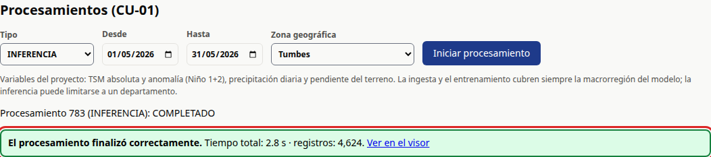
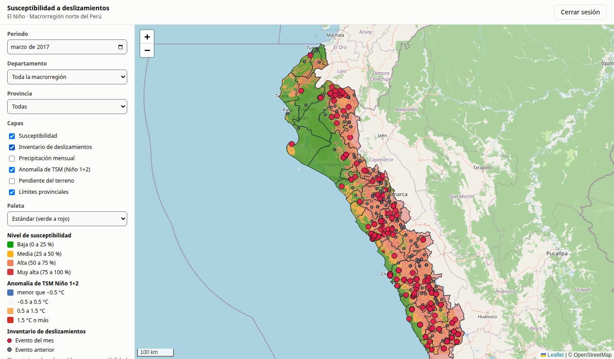

# Manual de usuario

Sistema de estimación de susceptibilidad a deslizamientos por El Niño · versión 1.0.2

## 1.1 Introducción

Para el Equipo Investigador, el Especialista en Gestión de Riesgos y el Asesor del Proyecto. Este manual describe las tareas de la versión 1.0.2. Los botones y campos aparecen en **negrita**; los avisos se escriben entre comillas.

## 1.2 Descripción general del sistema

El sistema muestra la susceptibilidad a deslizamientos en el norte del Perú por mes y en celdas de 1 km. Apoya el análisis de las condiciones asociadas a El Niño. No emite alertas ni predice la fecha o la probabilidad de un deslizamiento.

| Rol | Panel de control | Visor de mapas |
| --- | --- | --- |
| Equipo Investigador | Ejecuta procesamientos, revisa indicadores e historial | Consulta mapas y cambia capas |
| Especialista en Gestión de Riesgos | No aplica | Consulta mapas y cambia capas |
| Asesor del Proyecto | Revisa indicadores e historial | No aplica |

## 1.3 Acceso al sistema

1. Abra en el navegador la dirección HTTPS que le entregó el responsable del sistema. El panel se abre en `/panel/` y el visor en `/visor/` dentro de esa dirección.
2. Ingrese su **Correo** y **Clave** y pulse **Entrar**.
3. Para salir, pulse **Cerrar sesión**, especialmente en equipos compartidos.
4. Para cambiar o recuperar la clave, solicite un restablecimiento al responsable indicado en la entrega. No hay autoservicio de contraseñas. No comparta su clave actual.

## 1.4 Guía por rol de usuario

### 1.4.1 Equipo Investigador

Este rol prepara los datos, ejecuta el procesamiento y comprueba sus resultados en el panel y en el visor.

#### 1.4.1.1 Ejecutar el procesamiento (CU-01)

**Objetivo.** Preparar los datos, entrenar el modelo o generar mapas de susceptibilidad para el periodo de trabajo.

**Requisitos previos.** Inicie sesión como investigador, defina un periodo y compruebe que no haya un procesamiento activo. Para generar mapas deben estar preparados los datos y el modelo.

**Pasos.**

1. Abra **Procesamientos (CU-01)** en el panel.
2. En **Tipo**, elija **INGESTA** para obtener y verificar datos, **ENTRENAMIENTO** para ajustar el modelo o **INFERENCIA** para generar estimaciones.
3. Complete **Desde** y **Hasta**. Para inferencia, elija un departamento o toda la macrorregión en **Zona geográfica**. Los otros tipos cubren toda la macrorregión.
4. Pulse **Iniciar procesamiento** y revise el resumen. Use **Volver** si hay que corregirlo.
5. Pulse **Confirmar e iniciar** y anote el número de procesamiento. Puede volver más tarde al panel para consultar el estado activo.
6. Al finalizar una inferencia, siga **Ver en el visor** para consultar los mapas.

**Captura.**

**Resultado esperado.** Aparece «El procesamiento finalizó correctamente», con la duración y el total de registros.

**Errores posibles.** Si falla una fuente, descargue el archivo del portal oficial indicado, selecciónelo en el aviso y pulse **Cargar archivo y reanudar**. Se aceptan `.nc`, `.tif`, `.gpkg`, `.parquet`, `.csv` o `.ascii` de hasta 2 GB según la fuente. Si se rechazan los datos, revise la regla indicada y aporte un reemplazo. Para terminar sin guardar resultados parciales, pulse **Cancelar procesamiento** y **Sí, cancelar**. Consulte el apartado 1.7.

#### 1.4.1.2 Revisar indicadores (CU-03)

**Objetivo.** Comprobar la calidad del modelo y la operación del procesamiento.

**Requisitos previos.** Debe existir un procesamiento completo y debe haber iniciado sesión como investigador.

**Pasos.**

1. Abra **Indicadores (CU-03)** en el panel.
2. Revise la métrica predictiva, el tiempo y los registros procesados y rechazados.
3. Pulse **Exportar indicadores (CSV)** para conservar los valores mostrados.

**Captura.**

**Resultado esperado.** Se muestran los valores disponibles y el CSV queda descargado si se solicitó.

**Errores posibles.** Si hay un indicador por debajo del umbral, compruebe el periodo y la versión evaluada y registre la incidencia; vea 1.7.

#### 1.4.1.3 Consultar el historial (CU-05)

**Objetivo.** Revisar lo ocurrido durante los procesamientos y localizar advertencias o errores.

**Requisitos previos.** Debe haber iniciado sesión como investigador y existir operaciones registradas.

**Pasos.**

1. Abra **Historial de operaciones (CU-05)**.
2. Indique las fechas y elija un **Tipo** de evento.
3. Pulse **Filtrar** y revise la fecha y hora, tipo, descripción y usuario de cada fila.

**Captura.**

**Resultado esperado.** La tabla muestra los eventos que coinciden con los filtros.

**Errores posibles.** Si no aparecen registros, amplíe el rango de fechas o seleccione otro tipo; vea 1.7.

#### 1.4.1.4 Verificar mapas (CU-02)

**Objetivo.** Confirmar que se pueden consultar las estimaciones generadas.

**Requisitos previos.** Debe haber iniciado sesión como investigador y existir un mapa para el mes.

**Pasos.**

1. Abra el **Visor** y seleccione el mes procesado.
2. Filtre por departamento y, si corresponde, por provincia.
3. Pulse una celda para consultar su nivel y sus variables.

**Captura.**

**Resultado esperado.** Se ve el mapa filtrado y el detalle de la celda.

**Errores posibles.** Si el periodo no tiene resultados, revise la ejecución en el panel o elija otro mes; vea 1.7.

#### 1.4.1.5 Comparar capas (CU-04)

**Objetivo.** Contrastar la susceptibilidad con las capas de contexto.

**Requisitos previos.** Visor abierto con el mes y ámbito de interés seleccionados.

**Pasos.**

1. Abra **Capas** en el visor.
2. Active las capas que desea comparar y desactive las que oculten el detalle.
3. Revise la leyenda y contraste la misma zona en las capas seleccionadas.

**Captura.**

**Resultado esperado.** El visor cambia las capas sin perder el ámbito seleccionado.

**Errores posibles.** Si una capa no carga, continúe con las otras y vuelva a intentarlo; vea 1.7.

### 1.4.2 Especialista en Gestión de Riesgos

Este rol consulta los mapas y usa las capas para analizar una zona y un mes.

#### 1.4.2.1 Consultar y filtrar mapas (CU-02)

**Objetivo.** Identificar la susceptibilidad y las variables disponibles en una celda.

**Requisitos previos.** Inicie sesión como especialista y elija un periodo con mapas procesados.

**Pasos.**

1. Abra el visor y seleccione **Periodo (mes)**.
2. Seleccione el departamento y, si necesita mayor detalle, una provincia.
3. Pulse una celda y revise el nivel, la precipitación, la anomalía de TSM y la pendiente disponibles.

**Captura.**

**Resultado esperado.** El mapa se limita al ámbito elegido y el detalle corresponde a la celda pulsada.

**Errores posibles.** Si se indica que no hay datos, cambie de mes; si el dato debería existir, repórtelo; vea 1.7.

#### 1.4.2.2 Gestionar capas del visor (CU-04)

**Objetivo.** Superponer información para interpretar la susceptibilidad con su contexto geográfico.

**Requisitos previos.** Abra un mapa con datos para el mes seleccionado.

**Pasos.**

1. Abra **Capas**.
2. Marque o desmarque **Susceptibilidad**, **Inventario de deslizamientos**, **Precipitación mensual**, **Anomalía de TSM**, **Pendiente del terreno** o **Límites provinciales**, según su consulta.
3. Contraste el mapa con la leyenda. Use la paleta accesible si necesita distinguir mejor los niveles.

**Captura.**

**Resultado esperado.** El visor muestra las capas seleccionadas. En el inventario, los eventos del propio mes se distinguen en rojo.

**Errores posibles.** Si una capa no está disponible, las otras siguen visibles; desactívela y pruebe de nuevo más tarde; vea 1.7.

### 1.4.3 Asesor del Proyecto

Este rol revisa los resultados de evaluación y el historial, sin iniciar procesamientos.

#### 1.4.3.1 Visualizar y exportar indicadores (CU-03)

**Objetivo.** Revisar el rendimiento y guardar sus indicadores para el seguimiento.

**Requisitos previos.** Inicie sesión como asesor. Para una revisión completa debe existir un procesamiento finalizado.

**Pasos.**

1. Abra **Indicadores (CU-03)** en el panel.
2. Revise la métrica predictiva, el tiempo y los conteos de registros.
3. Pulse **Exportar indicadores (CSV)** y compruebe la descarga en el navegador.

**Captura.**

**Resultado esperado.** Obtiene un CSV con los indicadores mostrados.

**Errores posibles.** Si ve «Rendimiento por debajo del nivel esperado», comuníquelo al Equipo Investigador indicando el indicador; vea 1.7.

#### 1.4.3.2 Auditar operaciones (CU-05)

**Objetivo.** Reconstruir qué ocurrió y quién intervino en un periodo.

**Requisitos previos.** Inicie sesión como asesor y disponga de un rango de fechas.

**Pasos.**

1. Abra **Historial de operaciones (CU-05)**.
2. Defina el rango de fechas y seleccione el tipo de evento.
3. Pulse **Filtrar** y localice el evento por su fecha y descripción.

**Captura.**

**Resultado esperado.** Se muestran las operaciones coincidentes, con su fecha y usuario cuando está identificado.

**Errores posibles.** Un filtro sin coincidencias no significa que se hayan perdido datos; amplíe las fechas o cambie el tipo; vea 1.7.

## 1.5 Consultas y reportes

En el visor, combine mes, departamento y provincia para acotar los mapas. Los niveles ordenan las celdas de menor a mayor susceptibilidad; no son porcentajes de probabilidad. Registre el mes, ámbito y capas al compartir una interpretación. En el panel, filtre el historial por fecha y tipo y use **Exportar indicadores (CSV)**. El historial y el mapa se consultan en pantalla; esta exportación se refiere solo a los indicadores.

## 1.6 Administración funcional

La interfaz no permite crear, editar o desactivar cuentas, asignar roles ni cambiar parámetros globales. Solicite esos cambios al responsable del sistema por el canal de soporte. Indique correo, rol requerido, motivo y aprobación; para una baja, indique cuándo debe dejar de usarse la cuenta. Nunca incluya claves. Los filtros del visor y los parámetros de un procesamiento son opciones de trabajo, no cambios de permisos.

## 1.7 Mensajes y solución de problemas

| Mensaje o síntoma | Causa | Qué hacer |
| --- | --- | --- |
| «Correo o clave incorrectos» o cuenta bloqueada | Credenciales inválidas o cinco intentos fallidos | Revise sus datos; si está bloqueada, espere 15 minutos o solicite desbloqueo. |
| Sesión cerrada o acceso denegado | Sesión caducada o rol sin permisos | Inicie sesión de nuevo; si persiste, confirme el rol con soporte. |
| «Ya existe un procesamiento en curso» | Hay otro trabajo activo | Espere a que termine; no lo cancele sin coordinar con quien lo inició. |
| «Fuente externa no disponible» | No se obtuvo el dato de la fuente | Use el archivo oficial y reanude como indica 1.4.1.1. |
| «Datos rechazados en la verificación» | El archivo no cumple una regla indicada en pantalla | Use un archivo corregido o cancele el trabajo. |
| «No existen datos procesados para el periodo seleccionado» | No hay un mapa para ese mes | Elija otro mes o solicite al investigador revisar el periodo. |
| «Esta capa no está disponible; las demás siguen visibles» | Falló la carga de una capa | Pruebe de nuevo más tarde; indique la capa y el mes si reporta el error. |
| «Rendimiento por debajo del nivel esperado» | Una métrica no alcanza su umbral | Registre el resultado y comuníquelo al Equipo Investigador. |
| «No existen registros para el criterio seleccionado» | No hay eventos con el filtro elegido | Amplíe las fechas o cambie de tipo de evento. |
| Error inesperado | La operación no pudo completarse | Recargue y, si persiste, registre qué hizo y el mensaje observado. |

## 1.8 Soporte, preguntas frecuentes y glosario

**Soporte durante el piloto.** Comunique el problema al Equipo Investigador durante la sesión de validación o use el correo privado acordado para el piloto. Indique rol, fecha y hora, tarea, pasos, mensaje y número de procesamiento si lo tiene. Adjunte una captura sin datos sensibles. El [plan de soporte](plan_soporte.md) describe la atención hasta el cierre técnico; no se ofrece soporte posterior como parte del proyecto.

**¿Puedo cerrar el navegador mientras se procesa?** Sí. Al volver al panel verá el trabajo activo si no ha terminado.

**¿Un nivel alto equivale a una alerta?** No. Es un resultado relativo útil para análisis, no una predicción ni un aviso de emergencia.

| Término | Significado |
| --- | --- |
| Celda | Cuadro de 1 km del área de análisis. |
| Susceptibilidad | Puntaje relativo que ordena zonas bajo las condiciones analizadas. |
| Anomalía de TSM | Diferencia entre la temperatura superficial del mar y su referencia climatológica. |
| Inventario | Registro histórico de deslizamientos observados. |
| Inferencia | Cálculo de estimaciones de susceptibilidad para los datos seleccionados. |