# Manual de usuario

**Sistema de estimación de la susceptibilidad a deslizamientos por El Niño en el norte del Perú**
Versión 1.0.0 · noviembre de 2026

El manual sigue los cinco casos de uso del sistema (CU-01 a CU-05). Cada capítulo reproduce la
especificación del caso de uso: actor, precondición, flujo normal paso a paso, flujos alternativos,
postcondición y criterio de aceptación. Cada paso lleva una captura del sistema real. En las capturas,
el recuadro rojo señala el control que usa el actor en ese paso.

El sistema es una prueba de concepto académica: **no es un sistema de alerta** y no sustituye las
funciones de CENEPRED ni de INDECI.

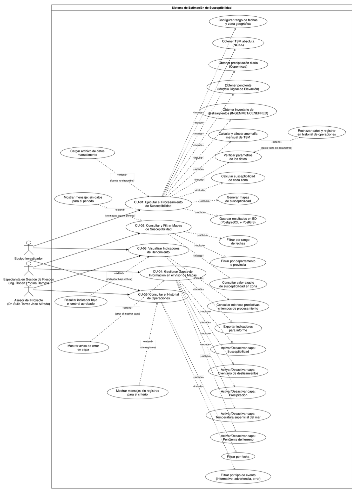

## Contenido

0. [Antes de empezar: acceso y roles](#0-antes-de-empezar-acceso-y-roles)
1. [CU-01: Ejecutar el procesamiento de susceptibilidad](#cu-01-ejecutar-el-procesamiento-de-susceptibilidad)
2. [CU-02: Consultar y filtrar mapas de susceptibilidad](#cu-02-consultar-y-filtrar-mapas-de-susceptibilidad)
3. [CU-03: Visualizar indicadores de rendimiento](#cu-03-visualizar-indicadores-de-rendimiento)
4. [CU-04: Gestionar capas de información en el visor de mapas](#cu-04-gestionar-capas-de-información-en-el-visor-de-mapas)
5. [CU-05: Consultar el historial de operaciones](#cu-05-consultar-el-historial-de-operaciones)
6. [Cómo interpretar los resultados](#6-cómo-interpretar-los-resultados)
7. [Mensajes del sistema](#7-mensajes-del-sistema)

---

## 0. Antes de empezar: acceso y roles

**Requisitos.** Un navegador actualizado (Google Chrome, Mozilla Firefox o Microsoft Edge), sin
instalar programas ni complementos, y una cuenta entregada por el administrador. Las cuentas no se
crean desde la web.

**Iniciar sesión (IU-01).** Abra la dirección del sistema (`https://<servidor>/panel/` o
`https://<servidor>/visor/`), escriba su correo y su clave y pulse **Entrar**. El sistema lo lleva a la
pantalla de su rol (IU-02).

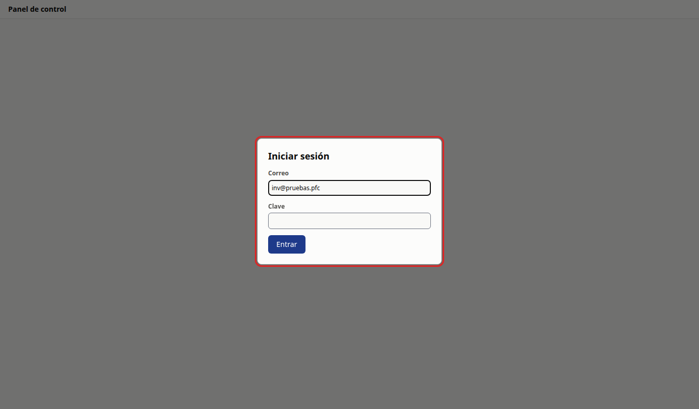

Si el correo o la clave no coinciden, aparece un aviso (IU-03). Al quinto intento fallido la cuenta se
bloquea 15 minutos. Para salir pulse **Cerrar sesión**; la sesión también termina al cerrar el
navegador.

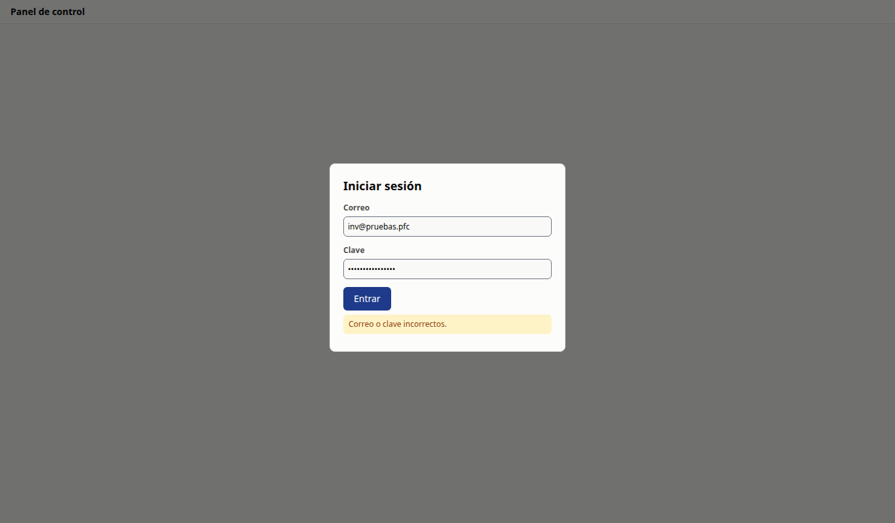

**Roles.**

| Caso de uso | Equipo Investigador | Especialista en Gestión de Riesgos | Asesor del Proyecto |
|---|:---:|:---:|:---:|
| CU-01 Ejecutar el procesamiento | Actor | — | — |
| CU-02 Consultar y filtrar mapas | Permitido | Actor | — |
| CU-03 Visualizar indicadores | Actor | — | Actor |
| CU-04 Gestionar capas | Permitido | Actor | — |
| CU-05 Consultar el historial | Actor | — | Actor |

---

## CU-01: Ejecutar el procesamiento de susceptibilidad

| | |
|---|---|
| **Actor** | Equipo Investigador |
| **Descripción** | Configura el rango de fechas y la zona geográfica e inicia el procesamiento. El sistema obtiene la TSM de NOAA, la precipitación diaria de Copernicus, la pendiente del modelo digital de elevación y el inventario de INGEMMET y CENEPRED; verifica los datos, calcula la susceptibilidad, genera los mapas y guarda los resultados. |
| **Precondición** | El sistema y la base de datos están operativos. |
| **Pantallas** | IU-04 a IU-11 del panel de control |

### Flujo normal

**Paso 1. El Equipo Investigador accede al panel de control del sistema.**
Abra `https://<servidor>/panel/` con su cuenta. La sección **Procesamientos (CU-01)** está arriba
(IU-04).

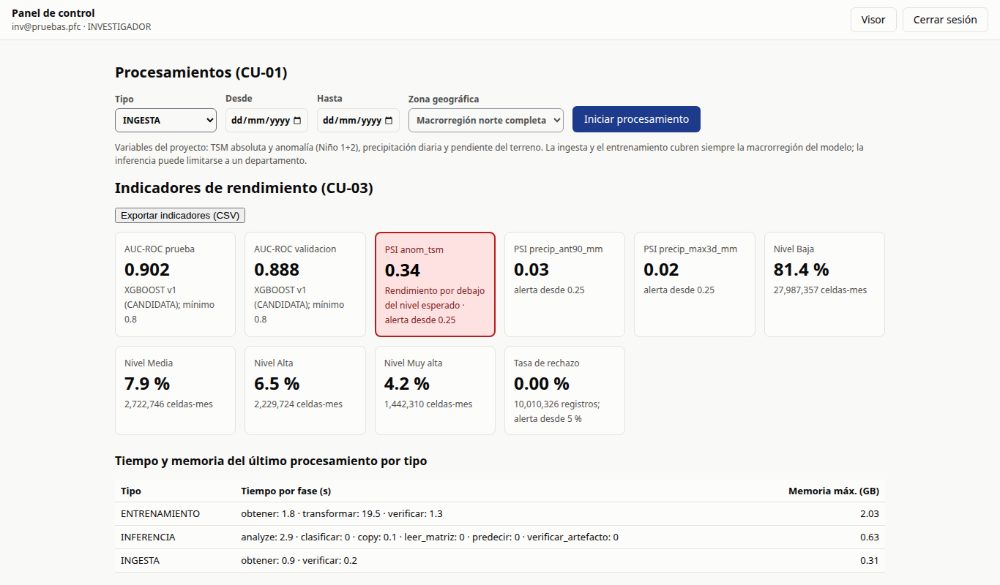

**Paso 2. Ingresa el rango de fechas y la zona geográfica que desea procesar.**
Elija el **Tipo** (INGESTA para obtener y verificar los datos, ENTRENAMIENTO para reentrenar el modelo,
INFERENCIA para calcular la susceptibilidad). Ingrese **Desde** y **Hasta**, y en **Zona geográfica**
elija un departamento o toda la macrorregión. La zona aplica a la inferencia; la ingesta y el
entrenamiento cubren siempre toda la macrorregión. Pulse **Iniciar procesamiento**.

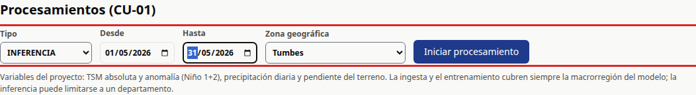

**Paso 3. Confirma el inicio del procesamiento.**
El sistema muestra el resumen (IU-05): tipo, ventana, zona, variables y número de estimaciones. Revíselo
y pulse **Confirmar e iniciar**. Con **Volver** regresa al formulario sin crear nada.

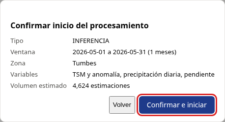

**Pasos 4 a 9. El sistema obtiene los datos, calcula la anomalía de TSM, verifica los datos, calcula
la susceptibilidad, genera los mapas y guarda los resultados.**
Estos pasos los realiza el sistema. El panel muestra el número del procesamiento, su estado y la fase
en curso (IU-06). Puede cerrar la página: al volver, el panel recupera el procesamiento activo. Solo
puede haber un procesamiento activo a la vez.

**Paso 10. El sistema notifica que el procesamiento finalizó correctamente.**
Aparece **«El procesamiento finalizó correctamente»** con el tiempo total y el número de registros
(IU-07). El enlace **Ver en el visor** abre los mapas.

### Flujo alternativo 4a: una fuente no responde

Si el sistema no puede obtener los datos de una fuente, detiene la descarga automática, muestra una
alerta visual y habilita la carga manual.

1. El panel muestra **«Fuente externa no disponible»** con el nombre de la fuente (IU-08). El
   procesamiento queda en espera y el error se registra en el historial.

   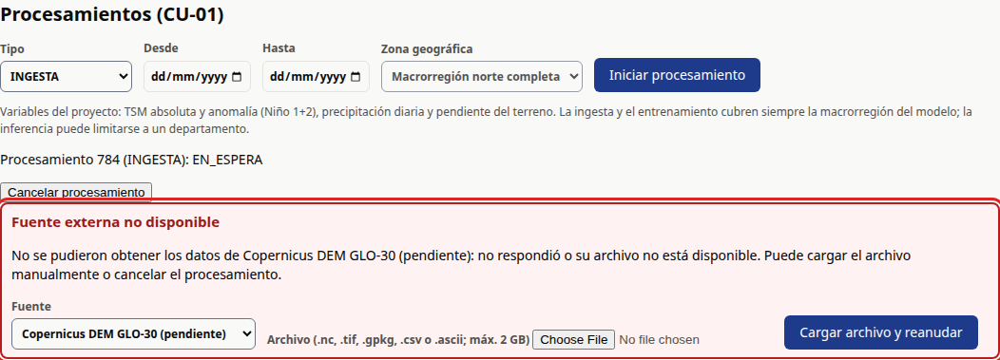

2. Descargue el archivo desde el portal oficial de esa fuente. En el formulario de la alerta la fuente
   ya está seleccionada: elija el archivo y pulse **Cargar archivo y reanudar** (IU-09). Se aceptan
   archivos `.nc`, `.tif`, `.gpkg`, `.parquet`, `.csv` o `.ascii` de hasta 2 GB, con un contenido que
   corresponda a la extensión.

   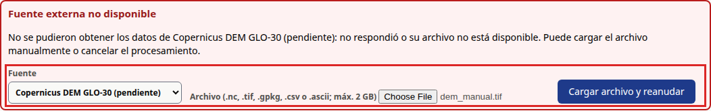

3. El sistema registra el archivo con su huella SHA-256 y reanuda la verificación.

   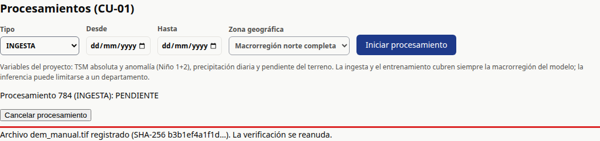

### Flujo alternativo 6a: los datos no cumplen los parámetros de verificación

El sistema rechaza los datos, registra el problema en el historial e indica qué parámetro no se cumplió.
El procesamiento no continúa hasta que los datos se reemplacen o el Equipo Investigador lo cancele.

1. El panel muestra **«Datos rechazados en la verificación»** con la fuente, la regla incumplida y el
   detalle (IU-10). Para reemplazar los datos, use la carga manual como en el flujo 4a.

   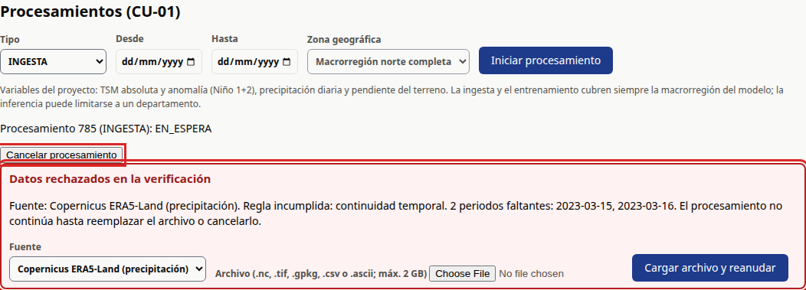

2. Para cancelar, pulse **Cancelar procesamiento** y confirme con **Sí, cancelar** (IU-11). Los
   resultados parciales no se guardan.

   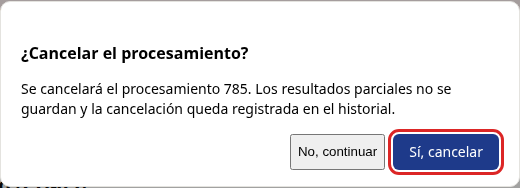

3. El estado pasa a **CANCELADO** y la cancelación queda en el historial.

   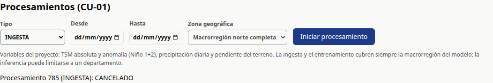

### Postcondición y criterio de aceptación

Los mapas de susceptibilidad quedan almacenados y listos para consultarse en el visor.

- **Escenario 1, procesamiento exitoso:** con parámetros correctos, el sistema completa los pasos 4 a 9
  sin errores y lo notifica (paso 10).
- **Escenario 2, falla en una fuente:** el error se registra en el historial y se permite la carga
  manual (flujo 4a).
- **Escenario 3, datos fuera de parámetros:** los datos se rechazan, se registran y se indica el
  parámetro incumplido (flujo 6a).

---

## CU-02: Consultar y filtrar mapas de susceptibilidad

| | |
|---|---|
| **Actor** | Especialista en Gestión de Riesgos |
| **Descripción** | Usa el visor de mapas, filtra por mes y por departamento o provincia y, con un clic sobre una zona, consulta su nivel de susceptibilidad y sus datos de TSM, precipitación y pendiente. |
| **Precondición** | Existen mapas de susceptibilidad procesados para el periodo que se desea consultar. |
| **Pantallas** | IU-12, IU-14 e IU-15 del visor |

### Flujo normal

**Paso 1. El Especialista accede al visor de mapas.**
Abra `https://<servidor>/visor/` con su cuenta (IU-12).

**Paso 2. Selecciona un mes y un departamento o provincia en el panel de filtros.**
En **Periodo** elija el mes. En **Departamento** y, si quiere, en **Provincia**, elija la zona.

**Paso 3. El sistema muestra en el mapa únicamente las zonas que cumplen los filtros.**
El mapa se encuadra en la zona y colorea cada celda de 1 km según su nivel; la leyenda indica el nombre
y el rango de cada nivel.

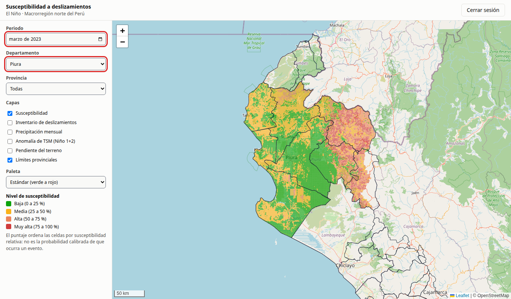

**Paso 4. El Especialista hace clic sobre una zona coloreada del mapa.**

**Paso 5. El sistema muestra una ventana con el valor exacto de susceptibilidad y los datos de TSM,
precipitación y pendiente de esa zona** (IU-14): nivel, puntaje del modelo con cuatro decimales,
precipitación del mes, máximo de tres días, antecedente de 90 días, anomalía de TSM de la región
Niño 1+2 y pendiente media y percentil 90.

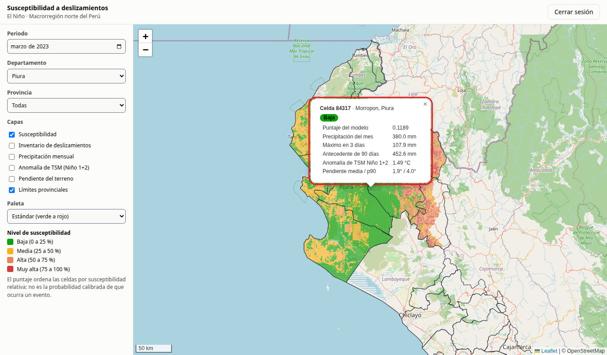

### Flujo alternativo 3a: no hay mapas para el mes solicitado

El sistema muestra **«No existen datos procesados para el periodo seleccionado»** (IU-15). Elija otro
mes o pida al Equipo Investigador que lo procese (CU-01).

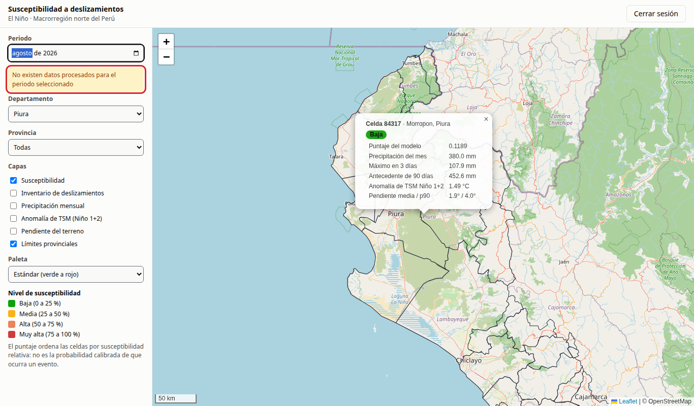

### Postcondición y criterio de aceptación

El Especialista obtiene la información para su análisis sin modificar los datos originales.

- **Escenario 1, consulta exitosa:** al filtrar por un mes con mapas y hacer clic en una zona, se
  muestran su valor de susceptibilidad y sus datos de TSM, precipitación y pendiente.
- **Escenario 2, consulta sin datos:** al filtrar por un mes sin mapas, se muestra «No existen datos
  procesados para el periodo seleccionado».

---

## CU-03: Visualizar indicadores de rendimiento

| | |
|---|---|
| **Actores** | Asesor del Proyecto y Equipo Investigador |
| **Descripción** | Consultan los indicadores de rendimiento: la métrica predictiva del protocolo de validación, el tiempo de procesamiento, los registros procesados y los rechazados. |
| **Precondición** | Se ejecutó al menos un procesamiento completo. |
| **Pantalla** | IU-16 del panel de control |

### Flujo normal

**Paso 1. El usuario accede al panel de indicadores.**
Abra `https://<servidor>/panel/`. Con la cuenta del Asesor el panel muestra los indicadores y el
historial; no muestra la sección de procesamientos.

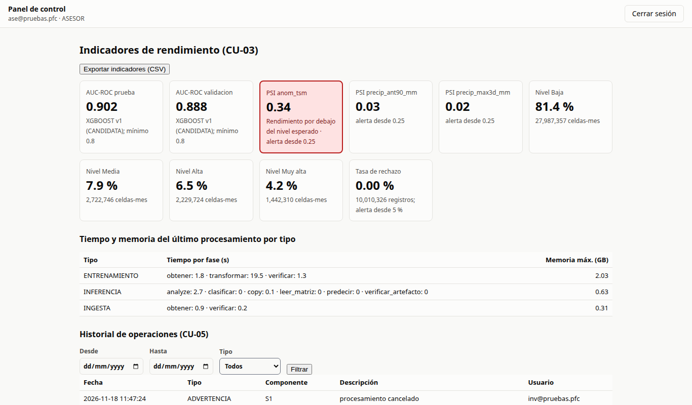

**Paso 2. El sistema consulta los indicadores almacenados.**

**Paso 3. El sistema muestra los indicadores en forma de gráficos:** AUC-ROC de prueba y de
validación, deriva de datos (PSI) de la anomalía de TSM y de la precipitación, distribución de las
celdas por nivel, tasa de rechazo de registros y, en la tabla inferior, el tiempo por fase y la memoria
máxima del último procesamiento de cada tipo.

**Paso 4. El usuario revisa los indicadores o los exporta para el informe del proyecto.**
Pulse **Exportar indicadores (CSV)** para descargar los valores mostrados.

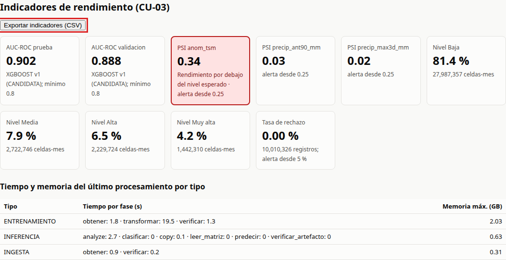

### Flujo alternativo 3a: un indicador no alcanza su umbral aprobado

El sistema resalta el indicador con el aviso **«Rendimiento por debajo del nivel esperado»**. En la
captura, el PSI de la anomalía de TSM (0.34) supera el umbral de alerta de 0.25: los datos recientes
se alejan de los de entrenamiento y conviene revisar el modelo.

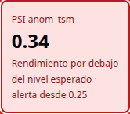

### Postcondición y criterio de aceptación

El Asesor y el Equipo Investigador disponen de los indicadores para evaluar la calidad del sistema.

- **Escenario 1, consulta exitosa:** el panel muestra los gráficos de rendimiento del protocolo.
- **Escenario 2, alerta de rendimiento bajo:** el indicador fuera de umbral se resalta con «Rendimiento
  por debajo del nivel esperado».

---

## CU-04: Gestionar capas de información en el visor de mapas

| | |
|---|---|
| **Actor** | Especialista en Gestión de Riesgos |
| **Descripción** | Activa y desactiva las capas del visor (mapa de susceptibilidad, inventario histórico de deslizamientos, precipitación, temperatura superficial del mar y pendiente del terreno) para compararlas sobre el mismo mapa. |
| **Precondición** | El visor está funcionando y hay capas disponibles. |
| **Pantalla** | IU-13 del visor |

### Flujo normal

**Paso 1. El Especialista accede al visor de mapas** (como en el paso 1 de CU-02).

**Paso 2. Abre el panel de capas de información**, en la columna izquierda del visor, bajo
**Capas**.

**Paso 3. Activa o desactiva las capas que desea ver.**

**Paso 4. El sistema actualiza el mapa inmediatamente, mostrando solo las capas seleccionadas,** sin
recargar la página. La leyenda muestra solo las capas activas. En la captura se activó **Susceptibilidad**
y se desactivó **Precipitación mensual**, como en el escenario de aceptación.

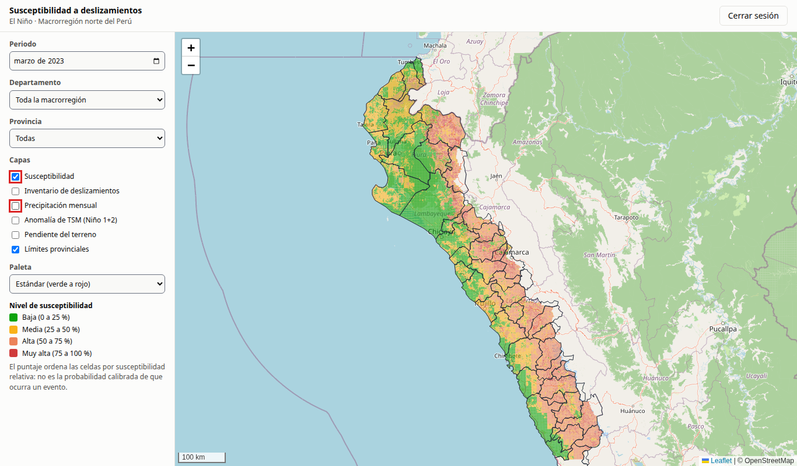

Las capas disponibles son:

| Capa | Qué muestra |
|---|---|
| Susceptibilidad | Nivel de cada celda en el mes elegido |
| Inventario de deslizamientos | Eventos hasta el fin del mes; los del propio mes, en rojo |
| Precipitación mensual | Lluvia acumulada del mes por celda |
| Anomalía de TSM (Niño 1+2) | Anomalía del mes respecto de 1991–2020 |
| Pendiente del terreno | Pendiente media por celda |
| Límites provinciales | Contorno de las provincias |

Ejemplo con la anomalía de TSM y el inventario en marzo de 2017 (El Niño costero):

### Flujo alternativo 4a: error al mostrar una capa

El sistema muestra un aviso junto al nombre de la capa y mantiene visibles las demás.

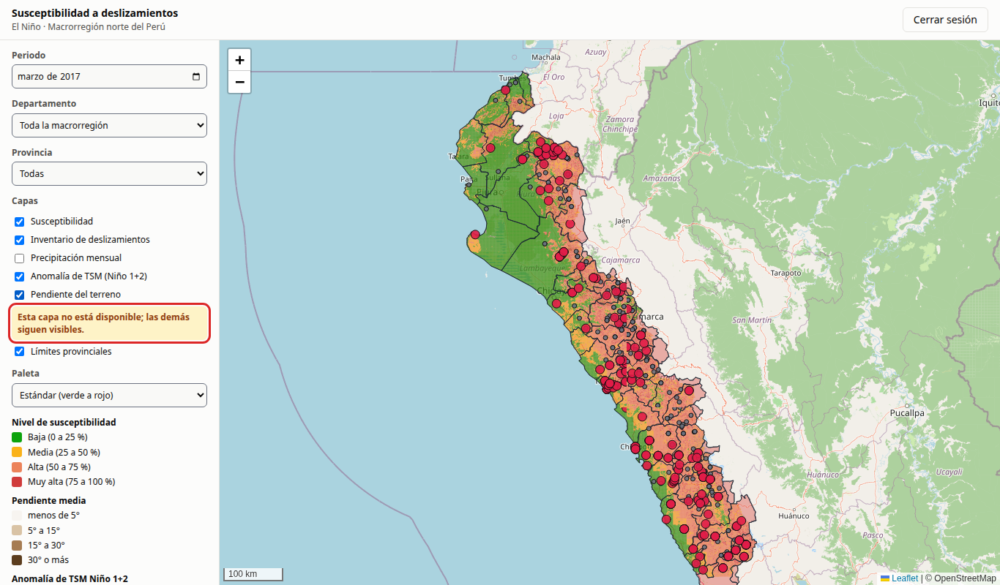

### Postcondición y criterio de aceptación

El visor muestra exactamente las capas que el Especialista necesita.

- **Escenario:** al activar «Mapa de Susceptibilidad» y desactivar «Precipitación», el mapa se
  actualiza inmediatamente y muestra solo la susceptibilidad, sin recargar la página.

**Paleta accesible.** En **Paleta** elija **Accesible** si tiene dificultad para distinguir el verde
del rojo. El nivel Muy alta lleva además una trama, y el navegador recuerda la elección.

---

## CU-05: Consultar el historial de operaciones

| | |
|---|---|
| **Actores** | Asesor del Proyecto y Equipo Investigador |
| **Descripción** | Revisan el historial de operaciones del sistema. Cada registro incluye fecha y hora, tipo de evento (informativo, advertencia o error), descripción y usuario. |
| **Precondición** | El sistema registró operaciones en su historial. |
| **Pantalla** | IU-17 del panel de control |

### Flujo normal

**Paso 1. El usuario accede al historial de operaciones**, en la sección **Historial de operaciones
(CU-05)** del panel.

**Paso 2. Aplica filtros por fecha o por tipo de evento** (informativo, advertencia o error) y pulsa
**Filtrar**.

**Paso 3. El sistema muestra la lista de operaciones registradas.**

**Paso 4. El usuario revisa los detalles de cada operación:** fecha y hora, tipo, componente,
descripción y usuario.

### Flujo alternativo 3a: ningún registro cumple el filtro

El sistema muestra **«No existen registros para el criterio seleccionado»**.

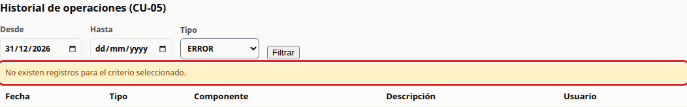

### Postcondición y criterio de aceptación

El usuario verifica el estado de las operaciones del sistema. El historial no puede modificarse ni
borrarse.

- **Escenario, consulta de errores:** al filtrar por el tipo «Error», el sistema muestra todos los
  errores registrados con su fecha, hora y descripción.

---

## 6. Cómo interpretar los resultados

- El **puntaje** ordena las celdas de mayor a menor susceptibilidad. **No es una probabilidad
  calibrada**: un puntaje de 0.80 no significa un 80 % de probabilidad de deslizamiento.
- Niveles: **Baja** (0 a 25 %), **Media** (25 a 50 %), **Alta** (50 a 75 %) y **Muy alta** (75 a 100 %).
- En la validación con 2020–2026, datos que el modelo nunca vio, el AUC-ROC fue de 0.902. En muestras
  con igual número de celdas con y sin deslizamiento, el 83 % de las celdas marcadas como susceptibles
  tuvieron un evento (precisión 1:1 de 0.834).
- Los deslizamientos son raros (alrededor de 1 de cada 6 300 celdas-mes en 2020–2026): la mayoría de las
  celdas en nivel Alto o Muy alto **no** tendrán un deslizamiento ese mes. Use los niveles para priorizar
  zonas de análisis, no como pronóstico de eventos.
- El modelo es válido para condiciones asociadas a El Niño y a una resolución de 1 km.

## 7. Mensajes del sistema

| Mensaje | Caso de uso | Qué hacer |
|---|---|---|
| Correo o clave incorrectos / cuenta bloqueada | Acceso | Revise la clave; tras 5 intentos espere 15 minutos o pida el desbloqueo |
| Ya existe un procesamiento en curso | CU-01, paso 3 | Espere a que termine o cancélelo |
| Fuente externa no disponible | CU-01, flujo 4a | Cargue el archivo manualmente |
| Datos rechazados en la verificación | CU-01, flujo 6a | Reemplace el archivo o cancele |
| El procesamiento finalizó correctamente | CU-01, paso 10 | Consulte los mapas en el visor |
| No existen datos procesados para el periodo seleccionado | CU-02, flujo 3a | Elija otro mes |
| Esta capa no está disponible; las demás siguen visibles | CU-04, flujo 4a | Vuelva a activarla más tarde |
| Rendimiento por debajo del nivel esperado | CU-03, flujo 3a | Informe al equipo para revisar el modelo |
| No existen registros para el criterio seleccionado | CU-05, flujo 3a | Amplíe las fechas o el tipo |
| Error del servidor (IU-18) | Cualquiera | Recargue; si persiste, avise al equipo |

Las capturas se generan con `scripts/capturas_manual.py` sobre el sistema en ejecución.
