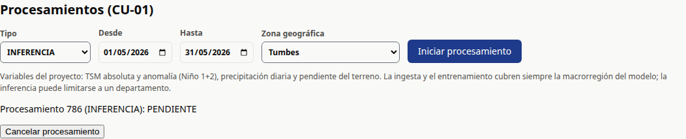
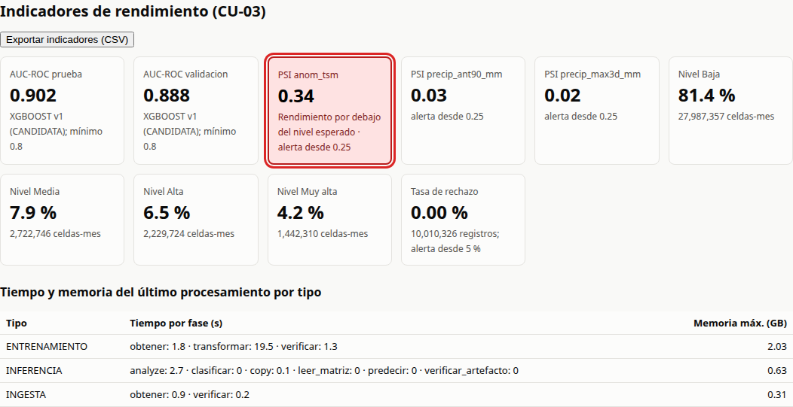
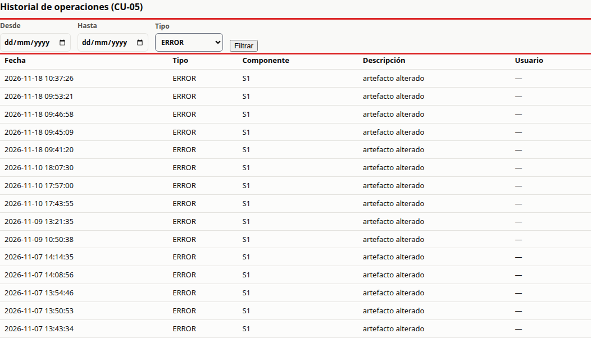
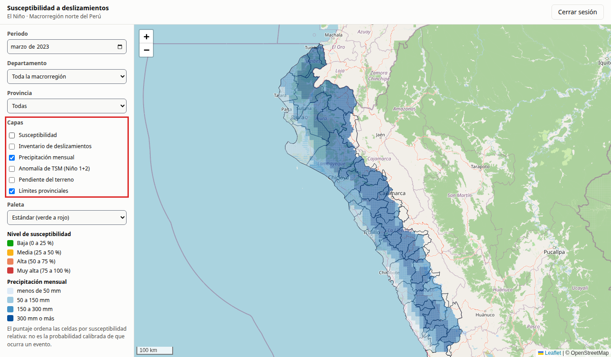
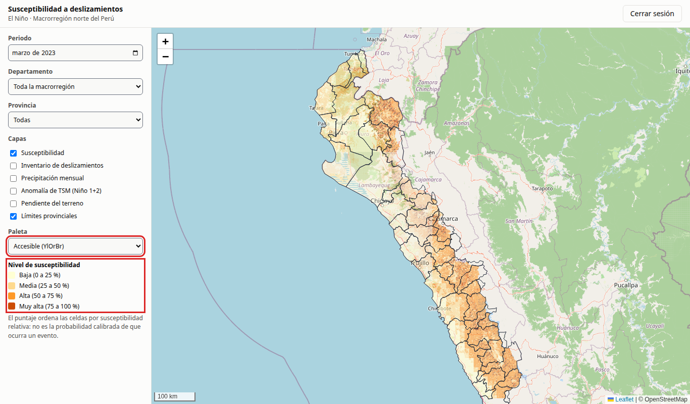

# Manual de usuario

Sistema de estimación de susceptibilidad a deslizamientos por El Niño · versión 1.0.2

## 1.1 Introducción

Este manual explica cómo usar la versión 1.0.2. Busque su rol en el apartado 1.4 y siga los pasos de la tarea que necesita. Los botones y campos aparecen en **negrita**. Si ve un aviso o algo no funciona, busque la pantalla correspondiente en el apartado 1.7.

## 1.2 Descripción general del sistema

El sistema muestra la susceptibilidad a deslizamientos en el norte del Perú por mes y en celdas de 1 km. Apoya el análisis de las condiciones asociadas a El Niño. No emite alertas ni predice la fecha o la probabilidad de un deslizamiento.

| Rol | Panel de control | Visor de mapas |
| --- | --- | --- |
| Equipo Investigador | Ejecuta procesamientos, revisa indicadores e historial | Consulta mapas y cambia capas |
| Especialista en Gestión de Riesgos | No aplica | Consulta mapas y cambia capas |
| Asesor del Proyecto | Revisa indicadores e historial | No aplica |

## 1.3 Acceso al sistema

1. Abra en el navegador la dirección HTTPS que le entregó el responsable del sistema. El panel se abre en `/panel/` y el visor en `/visor/` dentro de esa dirección.
2. Ingrese su **Correo** y **Clave** y pulse **Entrar**.
3. Para salir, pulse **Cerrar sesión**, especialmente en equipos compartidos.
4. Si olvidó su clave o necesita cambiarla, pida al Equipo Investigador que la restablezca. No hay un botón para hacerlo desde la pantalla de acceso. Nunca envíe su clave actual.

## 1.4 Guía por rol de usuario

### 1.4.1 Equipo Investigador

Este rol prepara los datos, ejecuta el procesamiento y comprueba sus resultados en el panel y en el visor.

#### 1.4.1.1 Ejecutar el procesamiento (CU-01)

**Objetivo.** Preparar los datos, entrenar el modelo o generar mapas de susceptibilidad para el periodo de trabajo.

**Requisitos previos.** Inicie sesión como investigador, defina un periodo y compruebe que no haya un procesamiento activo. Para generar mapas deben estar preparados los datos y el modelo.

**Pasos.**

1. Abra **Procesamientos (CU-01)** en el panel.
2. En **Tipo**, elija **INGESTA** para obtener y verificar datos, **ENTRENAMIENTO** para ajustar el modelo o **INFERENCIA** para generar estimaciones.
3. Complete **Desde** y **Hasta**. Para inferencia, elija un departamento o toda la macrorregión en **Zona geográfica**. Los otros tipos cubren toda la macrorregión.
4. Pulse **Iniciar procesamiento** y revise el resumen. Use **Volver** si hay que corregirlo.
5. Pulse **Confirmar e iniciar** y anote el número de procesamiento. Puede volver más tarde al panel para consultar el estado activo.
6. Al finalizar una inferencia, siga **Ver en el visor** para consultar los mapas.

**Captura.**

**Resultado esperado.** Aparece «El procesamiento finalizó correctamente», con la duración y el total de registros.

**Si el trabajo se detiene.** Lea el motivo junto al estado del procesamiento. Si falta un archivo o los datos no pasan la revisión, puede corregir el problema y continuar con el mismo trabajo. El apartado 1.7 explica cómo cargar el archivo adecuado, cuándo cancelar y qué hacer si aparece **FALLIDO**.

#### 1.4.1.2 Revisar indicadores (CU-03)

**Objetivo.** Comprobar la calidad del modelo y la operación del procesamiento.

**Requisitos previos.** Debe existir un procesamiento completo y debe haber iniciado sesión como investigador.

**Pasos.**

1. Abra **Indicadores (CU-03)** en el panel.
2. Revise la métrica predictiva, el tiempo y los registros procesados y rechazados.
3. Pulse **Exportar indicadores (CSV)** para conservar los valores mostrados.

**Captura.**

**Resultado esperado.** Se muestran los valores disponibles y el CSV queda descargado si se solicitó.

**Errores posibles.** Si hay un indicador por debajo del umbral, compruebe el periodo y la versión evaluada y registre la incidencia; vea 1.7.

#### 1.4.1.3 Consultar el historial (CU-05)

**Objetivo.** Revisar lo ocurrido durante los procesamientos y localizar advertencias o errores.

**Requisitos previos.** Debe haber iniciado sesión como investigador y existir operaciones registradas.

**Pasos.**

1. Abra **Historial de operaciones (CU-05)**.
2. Indique las fechas y elija un **Tipo** de evento.
3. Pulse **Filtrar** y revise la fecha y hora, tipo, descripción y usuario de cada fila.

**Captura.**

**Resultado esperado.** La tabla muestra los eventos que coinciden con los filtros.

**Errores posibles.** Si no aparecen registros, amplíe el rango de fechas o seleccione otro tipo; vea 1.7.

#### 1.4.1.4 Verificar mapas (CU-02)

**Objetivo.** Confirmar que se pueden consultar las estimaciones generadas.

**Requisitos previos.** Debe haber iniciado sesión como investigador y existir un mapa para el mes.

**Pasos.**

1. Abra el **Visor** y seleccione el mes procesado.
2. Filtre por departamento y, si corresponde, por provincia.
3. Pulse una celda para consultar su nivel y sus variables.

**Captura.**

**Resultado esperado.** Se ve el mapa filtrado y el detalle de la celda.

**Errores posibles.** Si el periodo no tiene resultados, revise la ejecución en el panel o elija otro mes; vea 1.7.

#### 1.4.1.5 Comparar capas (CU-04)

**Objetivo.** Contrastar la susceptibilidad con las capas de contexto.

**Requisitos previos.** Visor abierto con el mes y ámbito de interés seleccionados.

**Pasos.**

1. Abra **Capas** en el visor.
2. Active las capas que desea comparar y desactive las que oculten el detalle.
3. Revise la leyenda y contraste la misma zona en las capas seleccionadas.

**Captura.**

**Resultado esperado.** El visor cambia las capas sin perder el ámbito seleccionado.

**Errores posibles.** Si una capa no carga, continúe con las otras y vuelva a intentarlo; vea 1.7.

### 1.4.2 Especialista en Gestión de Riesgos

Este rol consulta los mapas y usa las capas para analizar una zona y un mes.

#### 1.4.2.1 Consultar y filtrar mapas (CU-02)

**Objetivo.** Identificar la susceptibilidad y las variables disponibles en una celda.

**Requisitos previos.** Inicie sesión como especialista y elija un periodo con mapas procesados.

**Pasos.**

1. Abra el visor y seleccione **Periodo (mes)**.
2. Seleccione el departamento y, si necesita mayor detalle, una provincia.
3. Pulse una celda y revise el nivel, la precipitación, la anomalía de TSM y la pendiente disponibles.

**Captura.**

**Resultado esperado.** El mapa se limita al ámbito elegido y el detalle corresponde a la celda pulsada.

**Errores posibles.** Si se indica que no hay datos, cambie de mes; si el dato debería existir, repórtelo; vea 1.7.

#### 1.4.2.2 Gestionar capas del visor (CU-04)

**Objetivo.** Superponer información para interpretar la susceptibilidad con su contexto geográfico.

**Requisitos previos.** Abra un mapa con datos para el mes seleccionado.

**Pasos.**

1. Abra **Capas**.
2. Marque o desmarque **Susceptibilidad**, **Inventario de deslizamientos**, **Precipitación mensual**, **Anomalía de TSM**, **Pendiente del terreno** o **Límites provinciales**, según su consulta.
3. Contraste el mapa con la leyenda. Use la paleta accesible si necesita distinguir mejor los niveles.

**Captura.**

**Resultado esperado.** El visor muestra las capas seleccionadas. En el inventario, los eventos del propio mes se distinguen en rojo.

**Errores posibles.** Si una capa no está disponible, las otras siguen visibles; desactívela y pruebe de nuevo más tarde; vea 1.7.

### 1.4.3 Asesor del Proyecto

Este rol revisa los resultados de evaluación y el historial, sin iniciar procesamientos.

#### 1.4.3.1 Visualizar y exportar indicadores (CU-03)

**Objetivo.** Revisar el rendimiento y guardar sus indicadores para el seguimiento.

**Requisitos previos.** Inicie sesión como asesor. Para una revisión completa debe existir un procesamiento finalizado.

**Pasos.**

1. Abra **Indicadores (CU-03)** en el panel.
2. Revise la métrica predictiva, el tiempo y los conteos de registros.
3. Pulse **Exportar indicadores (CSV)** y compruebe la descarga en el navegador.

**Captura.**

**Resultado esperado.** Obtiene un CSV con los indicadores mostrados.

**Errores posibles.** Si ve «Rendimiento por debajo del nivel esperado», comuníquelo al Equipo Investigador indicando el indicador; vea 1.7.

#### 1.4.3.2 Auditar operaciones (CU-05)

**Objetivo.** Reconstruir qué ocurrió y quién intervino en un periodo.

**Requisitos previos.** Inicie sesión como asesor y disponga de un rango de fechas.

**Pasos.**

1. Abra **Historial de operaciones (CU-05)**.
2. Defina el rango de fechas y seleccione el tipo de evento.
3. Pulse **Filtrar** y localice el evento por su fecha y descripción.

**Captura.**

**Resultado esperado.** Se muestran las operaciones coincidentes, con su fecha y usuario cuando está identificado.

**Errores posibles.** Un filtro sin coincidencias no significa que se hayan perdido datos; amplíe las fechas o cambie el tipo; vea 1.7.

## 1.5 Consultas y reportes

**Para explicar un mapa**, anote el mes, el departamento o provincia y las capas que estaban activas. Con esos datos, otra persona puede revisar la misma vista. Un nivel alto identifica una zona más susceptible que otras; no indica un porcentaje de probabilidad ni una fecha de deslizamiento.

**Para revisar lo ocurrido**, use **Historial de operaciones** y filtre por fecha y tipo. **Para guardar los indicadores**, pulse **Exportar indicadores (CSV)** y busque el archivo en las descargas del navegador. Ese archivo contiene los indicadores, no el mapa ni el historial.

## 1.6 Administración funcional

No hay una pantalla para crear, modificar o desactivar cuentas, cambiar permisos o ajustar opciones generales del sistema. Durante el piloto, solicite ese cambio al Equipo Investigador por el canal privado del apartado 1.8. Indique el correo de la cuenta, el rol que necesita, el motivo y quién autorizó el cambio. Si pide dar de baja una cuenta, diga desde cuándo. No incluya contraseñas.

Puede cambiar un filtro del mapa o las fechas de un procesamiento sin pedir un cambio de permisos: esas opciones solo afectan la tarea que está realizando.

## 1.7 Mensajes y solución de problemas

Busque el lugar donde apareció el aviso. Los textos entre comillas son mensajes del sistema; cuando el texto depende del navegador, del dato o de la operación, se indica cómo reconocerlo. No todos los avisos son errores: un filtro puede no tener coincidencias y un trabajo en espera puede continuar.

#### Acceso y sesión

| Lo que ve | Dónde aparece y qué significa | Qué hacer |
| --- | --- | --- |
| «Correo o clave incorrectos.» | Debajo de **Entrar**, en el panel o el visor. El sistema no pudo comprobar los datos de acceso. | Revise el correo, las mayúsculas y si está usando la clave más reciente. No siga probando claves al azar. Si no recuerda la suya, pida un restablecimiento. |
| «Cuenta bloqueada temporalmente por intentos fallidos.» | En el mismo formulario. La cuenta se bloquea después de cinco intentos fallidos. | Espere 15 minutos desde el bloqueo. Si no recuerda la clave, pida un restablecimiento en lugar de repetir los intentos. |
| «Demasiados intentos. Espere un momento.» | Debajo de **Entrar**. Se están limitando las solicitudes de acceso. | Deje de intentar por un momento y vuelva a probar una vez. Si sigue ocurriendo, anote la hora y contacte al equipo. |
| El navegador marca un campo sin enviar el formulario. | Junto a **Correo** o **Clave**. Falta un dato o el correo no tiene un formato válido. El texto depende del navegador. | Complete los dos campos y revise que el correo incluya su dirección completa. |
| Vuelve a salir el formulario de acceso, o aparece un aviso de sesión, permiso o seguridad de la solicitud. | Al abrir una página o al intentar una acción. Puede faltar una sesión válida o el rol no tiene permiso para esa tarea. | Vuelva a abrir la página e inicie sesión. Si no se permite la acción, compruebe su rol en el apartado 1.2. No use la cuenta de otra persona. |
| Abre el panel y vuelve al visor, o no ve una sección. | Al entrar con un rol que no usa esa pantalla. El Especialista pasa al visor; el Asesor no tiene acceso al visor y no inicia procesamientos. | Abra la tarea correspondiente a su rol. Si le asignaron un rol distinto del acordado, solicite su revisión. |

#### Panel: iniciar un procesamiento

Estos avisos aparecen en **Confirmar inicio del procesamiento**, después de pulsar **Confirmar e iniciar**, excepto los avisos del navegador, que aparecen junto a los campos del formulario.

| Lo que ve | Qué significa y qué hacer |
| --- | --- |
| El navegador marca **Desde** o **Hasta**. | Complete ambas fechas y use días entre el 1 de enero de 2000 y el 31 de diciembre de 2026, que son los límites del formulario. Que una fecha se pueda elegir no significa que existan datos para ella. |
| «fecha_hasta anterior a fecha_desde», o una fecha inválida o fuera del periodo. | Pulse **Volver** y corrija las fechas. **Hasta** debe ser igual o posterior a **Desde**. Revise el resumen antes de confirmar de nuevo. |
| «Ya existe un procesamiento en curso; espere a que termine o cancélelo.» | El sistema acepta un solo trabajo activo. Consulte su número y estado. Espere a que termine o coordine con quien lo inició antes de cancelarlo. |
| «no hay datos verificados para la ventana» | No hay datos revisados para entrenar en esas fechas. Compruebe la ingesta del periodo y sus rechazos. Si faltan datos, haga primero la ingesta o elija un periodo que ya esté preparado. |
| «el departamento no pertenece a la macrorregión» | La zona no es válida para el modelo. Pulse **Volver**, elija un departamento de **Zona geográfica** o use **Macrorregión norte completa**. |
| «la versión del modelo no se puede aplicar» o «el SHA-256 del artefacto no coincide» | El sistema no puede usar el modelo o no puede comprobar que su archivo esté intacto. No intente saltar esa comprobación. Informe al Equipo Investigador con tipo, fechas y zona para que revise la versión y el archivo del modelo. |
| Otro aviso sobre un campo inválido, faltante o no permitido. | Revise **Tipo**, fechas y zona en el formulario. Si el aviso vuelve a aparecer con datos válidos, copie el texto exacto: el Equipo Investigador necesita saber qué campo o solicitud se rechazó. |

#### Panel: trabajo en espera, carga de archivos y estado final

**«Fuente externa no disponible».** Aparece en **Procesamientos**, junto a **EN_ESPERA**. El aviso nombra la fuente que el sistema no pudo consultar. No necesita iniciar otro trabajo: si dispone del archivo oficial que corresponde a esa fuente y al periodo solicitado, puede cargarlo en el trabajo que ya está abierto.

**«Datos rechazados en la verificación».** Aparece en el mismo lugar. Lea **Regla incumplida** y el detalle para saber qué debe corregir. No vuelva a enviar el mismo archivo sin revisarlo: que un archivo se pueda subir no significa que sus datos sean válidos. Si no consigue un reemplazo adecuado, coordine la cancelación.

1. En el aviso de espera, compruebe **Fuente** y seleccione el archivo correcto en **Archivo**. El formulario anuncia `.nc`, `.tif`, `.gpkg`, `.csv` o `.ascii`, con un máximo de 2 GB. Use el formato que corresponde a la fuente; no cambie solo la extensión para intentar que se acepte.
2. Pulse **Cargar archivo y reanudar**. Si aparece «Archivo … registrado … La verificación se reanuda», el archivo fue recibido y se vuelve a revisar. Todavía no significa que el procesamiento terminó.
3. Lea el nuevo estado. Si vuelve a **EN_ESPERA**, revise el motivo nuevo. Si aparece **COMPLETADO**, el trabajo terminó. Use **Ver en el visor** para revisar los mapas si el trabajo fue una inferencia.

| Lo que ve | Dónde aparece y qué hacer |
| --- | --- |
| «Archivo rechazado: el tipo o el contenido no está permitido.» | Debajo del formulario de carga. Vuelva a descargar el archivo en el formato admitido y compruebe que abre correctamente; un nombre con la extensión correcta no basta. |
| «Archivo rechazado: supera el límite de 2 GB.» | Debajo del formulario de carga. Busque una descarga oficial que no supere el límite y que conserve la cobertura requerida. Si no existe, consulte al equipo antes de dividir el archivo o cancelar. |
| El navegador pide seleccionar un archivo, o aparece «se requieren archivo y fuente válidos». | Junto al campo o debajo del formulario. Seleccione el archivo y compruebe que **Fuente** corresponde al aviso antes de enviar. |
| «el procesamiento no está esperando archivos», «el procesamiento ya terminó» o aviso de que no se encontró el trabajo. | Debajo de la carga o en el aviso general al consultar o cancelar. El estado pudo cambiar desde que abrió el panel. Compruebe el número y vuelva a consultar el trabajo; no envíe el archivo a otro procesamiento. |
| **FALLIDO** | En la línea de estado. El trabajo terminó sin éxito. Anote su número y fase y busque el error en **Historial de operaciones**. Si no identifica la causa, informe al equipo antes de repetirlo con los mismos datos. |
| **CANCELADO** o «¿Cancelar el procesamiento?» | En la línea de estado o en la ventana de confirmación, respectivamente. Use **No, continuar** para conservar el trabajo, o **Sí, cancelar** para detenerlo. Los resultados parciales no se guardan y la cancelación se anota en el historial. |

#### Panel: indicadores e historial

| Lo que ve | Dónde aparece y qué hacer |
| --- | --- |
| «Rendimiento por debajo del nivel esperado» | Junto al indicador que necesita revisión. Puede significar que el modelo distingue peor las zonas (AUC-ROC menor que 0,80), que los datos cambiaron respecto a la referencia (PSI desde 0,25) o que se rechazó más del 5 % de registros. Anote el indicador, su valor y la versión o el periodo si los conoce. Comparta el CSV con el equipo para que revise la causa. El aviso no significa por sí solo que el trabajo falló. |
| «No existen registros para el criterio seleccionado.» | Debajo de los filtros del historial. No se encontraron eventos que coincidan. Revise **Desde** y **Hasta**, amplíe las fechas o elija **Todos** en **Tipo** y pulse **Filtrar**. No supone que se borraron registros. |
| Fecha o tipo inválido al filtrar. | En el aviso general del panel. Corrija las fechas o limpie el filtro, seleccione un tipo de la lista y pulse **Filtrar** de nuevo. Si ocurre con valores válidos, envíe al equipo los filtros utilizados. |
| No aparecen indicadores o no encuentra el CSV. | En el panel no siempre hay un aviso específico. Compruebe que se muestran resultados antes de exportar. Busque `indicadores_` en **Descargas** del navegador; si el archivo no aparece, revise si el navegador bloqueó la descarga. |

#### Visor: mes, capas y detalle del mapa

| Lo que ve | Dónde aparece y qué hacer |
| --- | --- |
| «No existen datos procesados para el periodo seleccionado» | Debajo de **Periodo (mes)**. No hay resultados publicados para ese mes. Elija otro mes o pida al Equipo Investigador que compruebe si terminó la inferencia. La ausencia de datos no equivale a un nivel bajo de susceptibilidad. |
| «Esta capa no está disponible; las demás siguen visibles.» | Debajo de la capa que falló en **Capas**. Puede seguir con las otras, pero no interprete la capa que no cargó. Desactive y vuelva a activar esa capa una vez. Si no carga, indique su nombre, mes y zona al reportar. |
| Pulsa el mapa y no aparece el detalle. | Puede no salir un mensaje si el punto no tiene datos para ese mes. Pulse dentro de una zona coloreada y confirme que la capa de susceptibilidad está activa. Si otras celdas responden pero esa no, anote el lugar y el mes. |
| Aviso de periodo o dato inválido. | En el aviso general del visor. Vuelva a elegir el mes en **Periodo (mes)** y revise el departamento y la provincia. Si sigue apareciendo con una selección válida, copie el mensaje y los filtros. |

#### Problemas de conexión y otros avisos

**«No se pudo conectar con el servidor. Los datos ingresados se conservan.»** Puede aparecer junto al formulario que estaba usando o como aviso general en el panel o visor. Compruebe su conexión. Antes de recargar, anote las opciones que eligió: el aviso no significa que se guarden al cerrar la página. Si ocurrió al confirmar un trabajo, subir un archivo o cancelar, revise el número y estado del trabajo antes de repetir la acción. La solicitud pudo llegar aunque la pantalla no recibiera respuesta.

**Otro error, página no encontrada o aviso del servicio.** Compruebe la dirección que recibió y qué estaba haciendo. Si era una consulta, vuelva a abrir la página una vez. Si era una acción que cambia el estado, compruebe primero su resultado. Si persiste, use el canal del apartado 1.8. Los detalles técnicos pueden variar; copie el texto que realmente vio, no una interpretación.

## 1.8 Soporte, preguntas frecuentes y glosario

**Soporte durante el piloto.** Avise al Equipo Investigador durante la sesión o escríbale al correo privado acordado. Diga quién estaba usando el sistema, cuándo ocurrió, qué pantalla tenía abierta, qué pulsó, qué esperaba y qué vio. Añada el número de procesamiento o el mes, la zona y la capa del mapa, si corresponde. Una captura sin claves ni datos privados ayuda a repetir el problema. El [plan de soporte](plan_soporte.md) explica la atención hasta el cierre técnico del piloto.

**¿Puedo cerrar el navegador mientras se procesa?** Sí. Cerrar la página no cancela el trabajo. Cuando vuelva, el panel mostrará el trabajo si sigue activo. Si ya terminó y no se muestra en pantalla, revise el historial.

**¿Un nivel alto equivale a una alerta?** No. Es un resultado relativo útil para análisis, no una predicción ni un aviso de emergencia.

| Término | Significado |
| --- | --- |
| Celda | Cuadro de 1 km del área de análisis. |
| Susceptibilidad | Indica qué zonas son más propensas a deslizamientos que otras según el modelo. No es una probabilidad. |
| Anomalía de TSM | Diferencia entre la temperatura de la superficie del mar y el valor habitual usado como referencia. |
| Inventario | Registro histórico de deslizamientos observados. |
| Inferencia | Uso de un modelo ya entrenado para calcular la susceptibilidad del periodo y la zona elegidos. |
| Capa | Información que se puede mostrar u ocultar sobre el mapa, como precipitación o límites. |